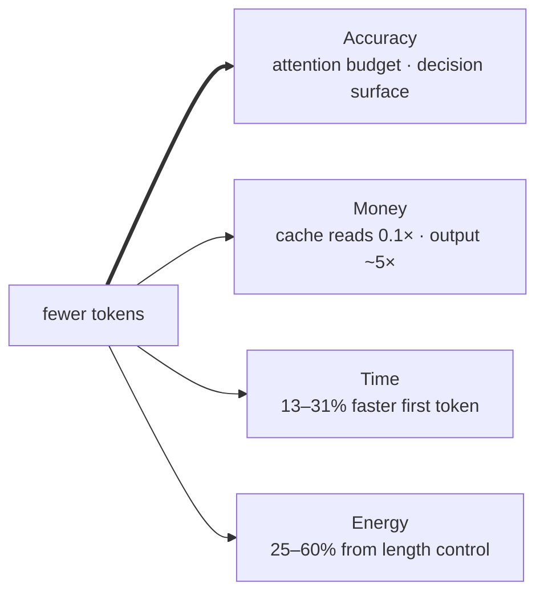
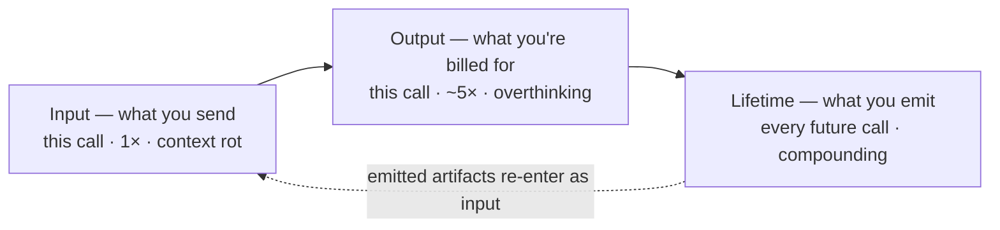
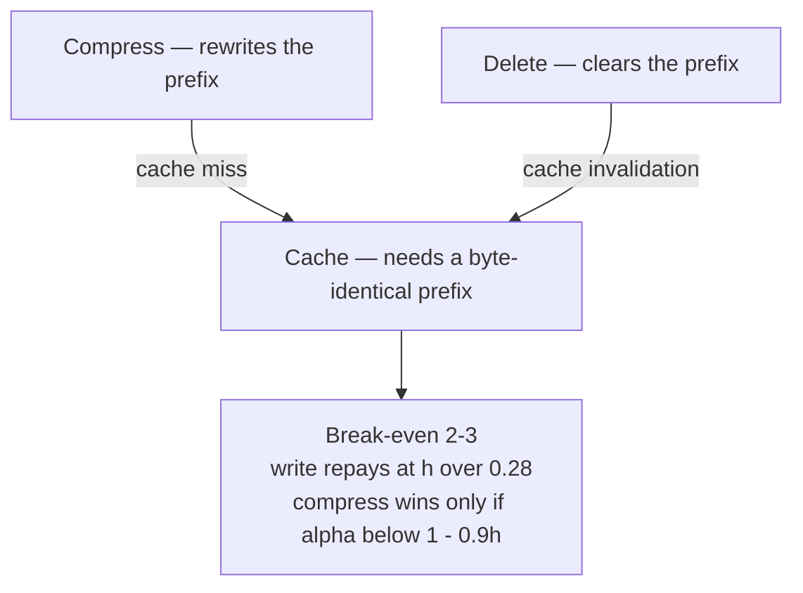

# Awesome Token Minimalism

[](https://awesome.re)
[](https://github.com/ranjithrajv/awesome-token-minimalism/actions/workflows/check.yml)
[](LICENSE)
[](.github/scripts/count_tokens.py)

> **Minimal in, minimal out, minimal forever.**
> Papers, tools, and patterns for spending fewer tokens on all three sides of an LLM call.

A token is spent **once when you send it**, **once when you receive it**, and
**every day after** for everything you emitted. Most of the industry optimizes
the first. The bill for the third is the one nobody has instrumented.

---

## Contents

- [How to read this](#how-to-read-this) — six routes in, plus the two conventions worth knowing first
- [Glossary](GLOSSARY.md) — every load-bearing term, defined once
- [Resources](RESOURCES.md) — external frameworks, essays, and analysis
- [Token Maxxing](TOKENMAXXING.md) — the negative results, from fleet-scale bills to optimizers that cost more
- [Showcase](SHOWCASE.md) — for maintainers: submit your own tool, with the grade stated honestly
- [The case](#the-case) — four gains, one lever, and the accuracy leads
  - [Four gains, one lever](#four-gains-one-lever) — the numbers
  - [The accuracy gain](#the-accuracy-gain) — five mechanisms, measured
  - [Why one lever moves all four](#why-one-lever-moves-all-four) — the mechanism, and its escape hatch
  - [The other lever on the same bill](#the-other-lever-on-the-same-bill) — tokens × cost-per-token
  - [The scale it adds up to](#the-scale-it-adds-up-to) — TWh, water, and lifecycle
  - [Where the case breaks](#where-the-case-breaks) — the exceptions, both halves
  - [The rule](#the-rule) — relevance density, not volume
- [The three legs](#the-three-legs) — the frame everything else hangs on
- [The measurement surface](#the-measurement-surface-in-one-line) — what you measure determines what you find
- [What counts as bloat](#what-counts-as-bloat) — and why the enemy is never capability
- [Evidence grades](#evidence-grades) — the one non-negotiable rule
- [Leg 0 — Measure](#leg-0--measure) — you cannot cut what you cannot see
- [Leg 1 — Input](#leg-1--input) — what you send
  - [📏 Effective context](#%F0%9F%93%8F-effective-context) — why every section after it exists
  - [🕸️ Graph engineering](#%F0%9F%95%B8%EF%B8%8F-graph-engineering) — 879 tokens vs 331,375 on the same corpus
  - [🖼️ Multimodal tokens](#%F0%9F%96%BC%EF%B8%8F-multimodal-tokens) — same pixels, ~16× spread
  - [📦 Serialize](#%F0%9F%93%A6-serialize) — same data, cheaper notation
  - [🗑️ Delete](#%F0%9F%97%91%EF%B8%8F-delete) — and why it spends your cache
  - [💾 Cache](#%F0%9F%92%BE-cache) — three mechanisms people conflate
- [Leg 2 — Output](#leg-2--output) — what you get billed for
  - [🎯 Decide, don't generate](#%F0%9F%8E%AF-decide-dont-generate) — the model class with no output stream
  - [⚙️ Run, don't generate](#%E2%9A%99%EF%B8%8F-run-dont-generate) — if a rule can express it, a codemod beats both
- [Leg 3 — Lifetime](#leg-3--lifetime) — what you emit becomes context forever
  - [🧠 Agent memory](#%F0%9F%A7%A0-agent-memory--reuse-what-you-emitted) — the lifetime leg, sold as a product
- [Serve-side](#serve-side-cost-and-latency-not-token-count) — cheaper without being fewer
- [Interaction matrix](#interaction-matrix) — where this list argues with itself
- [🧮 Break-even](#%F0%9F%A7%AE-break-even) — the arithmetic that settles those arguments
- [Laws](#laws)
- [Token ledger](#token-ledger) — advertised vs. measured
- [Open problems](OPEN-PROBLEMS.md) — sixteen questions nobody has measured
- [Anti-patterns](ANTI-PATTERNS.md) — nineteen defaults that shipped unmeasured
- [Related](#related) — adjacent lists, and this repo's measurement layer
- [Contributing](#contributing)
- [Citation](#citation) — how to reference this list
- [License](#license)

---

## How to read this

This list is long because the topic has three independent failure modes and
almost every tool addresses exactly one of them. Six routes, depending on why
you're here:

| If you want to… | Read |
|---|---|
| **Argue with the premise** | [The three legs](#the-three-legs) → [What counts as bloat](#what-counts-as-bloat) → [Interaction matrix](#interaction-matrix) |
| **Cut a bill this week** | [Leg 0](#leg-0--measure) (see the waste) → [Leg 1 · Cache](#%F0%9F%92%BE-cache) and [Leg 2 · Audit](#%F0%9F%93%90-audit) (find the two invisible costs) → [Token ledger](#token-ledger) (don't trust the tool's homepage) |
| **Build an agent** | [Effective context](#%F0%9F%93%8F-effective-context) → [Select](#%F0%9F%94%8E-select) → [Isolate](#%F0%9F%A7%B1-isolate) → [Reason less](#%F0%9F%A7%A0-reason-less) → [Laws](#laws) |
| **Make an agent more accurate** | [The accuracy gain](#the-accuracy-gain) → [Select](#%F0%9F%94%8E-select) (decision surface) → [Reason less](#%F0%9F%A7%A0-reason-less) (drift) → [Retention bars](#%F0%9F%AA%9E-retention-bars--dont-delete-without-one) (delete without losing guards) |
| **Justify it upward** | [The case](#the-case) (accuracy first, then money, time, energy) → [🧮 Break-even](#%F0%9F%A7%AE-break-even) (the arithmetic) → [Token ledger](#token-ledger) (the cautionary half) |
| **Review a tool someone recommended** | [Evidence grades](#evidence-grades) → [Token ledger](#token-ledger) → [Anti-patterns](ANTI-PATTERNS.md) |

Two conventions worth knowing before you start:

- **Every entry carries an evidence grade.** `[measured]` means someone stated a
  baseline and a method. **None of the three independently audited tools hit its
  headline** — one was *more expensive* than doing nothing. See
  [Token ledger](#token-ledger). The grade is the list, not the commentary.
- **The enemy is bloat, never capability.** Every entry keeps the feature and
  removes an unmeasured cost. If a technique can't be written that way, it's in
  [Anti-patterns](ANTI-PATTERNS.md) instead.

---

## The case

Four gains from one lever, and the primary one is not a cost: **less bloat is
more correct.** Money, time, and energy are what the same lever happens to cut
on the way there — worth having, and not the reason to believe it.

### Four gains, one lever

Token minimalism is not an aesthetic. Reducing tokens buys **a quality gain and
three cost reductions** at once — and the quality is the primary one, because it
is the gain a cost-saving framing would price at zero. Bloat is not merely
expensive; it is *wrong*, and the bill is the receipt, not the point.



| Gain | The number |
|---|---|
| 🎯 **Accuracy** | The primary gain, and the one a cost framing prices at zero: fewer tokens means **more attention per token** and a smaller [decision surface](#the-accuracy-gain), so accuracy moves *with* the spend rather than against it. Tool Search cut schemas **134k → 8.7k** and took tool selection **49% → 74%**; context editing measured **+29%** agentic-search performance at **−84%** tokens; LongMemEval's focused-vs-full arm wins across every model tested. TALE, MUTO and Chain of Draft all *raise* accuracy while shrinking output. Five mechanisms, [below](#the-accuracy-gain). |
| 💰 **Money** | Cache reads are **0.1×** input price — a 90% discount. Output is **~5×** input. Reasoning tokens are **>80% of total output cost** on some workloads and usually invisible on the dashboard. Context editing measured **−84% tokens** on a 100-turn eval. Graph indexing done the expensive way is ~**1,000×** the cost of the cheap way. |
| ⏱️ **Time** | Caching: **13–31%** faster first token. Precomputed KV (CAG): **0.85s vs 9.25s** on HotpotQA — ~11×, up to ~17×. Chain of Draft: **4.2s → 1.0s** per answer. Code-execution harnesses report **~79% faster** on multi-step work. And the failure case nobody prices: agents that exhaust context start *retrying*, and **6 of 13 tool calls** hit context overflow in one measured trace. |
| 🔋 **Energy** | Response-length control alone is **25–60% energy reduction** with quality preserved — the core answer turns out to be only **42%** of a typical response. Frontier inference is a median of **0.31 Wh/query**; a *reasoning* query at ~5,000 output tokens is **~13×** that. DeepSeek-R1 measured **20.9 Wh/query against 0.21 Wh** for a conventional model — ~100×. A short session can draw ~**0.5 litres of cooling water**. |

### The accuracy gain

This is about **being more right**, and it is the primary gain in the list. It
is also the most counter-intuitive one: token minimalism is sold as a cost play,
but in the cases that have been measured properly it is a *quality* play first.
Removing bloat does not trade accuracy for money — it recovers accuracy that the
bloat was destroying.

The inversion is worth stating plainly, because the reflex is wrong in a
specific, testable way:

> You are not removing context. You are removing **context that competes for
> attention with the context that matters.**

#### Five mechanisms

**1. [Attention budget](GLOSSARY.md#attention-budget) — fewer tokens means more attention per token.**
Every added token spends attention, useful or not, and irrelevant tokens spend
it more aggressively as input grows. This is [context rot](GLOSSARY.md#context-rot)
(18 models degraded) and [Lost in the Middle](https://aclanthology.org/2024.tacl-1.9/)
(relevant information in the middle of a long context falls to *closed-book*
accuracy). The cleanest experiment is LongMemEval's focused-versus-full arm:
same question, same relevant passages, only the distractors differ — **focused
input wins across every model tested.**
→ Practices: [Select](#%F0%9F%94%8E-select) · [Compress](#%E2%9C%82%EF%B8%8F-compress) · [Delete](#%F0%9F%97%91%EF%B8%8F-delete)

**2. Decision surface — fewer options means better choices.**
Bloated tool sets don't just cost tokens; they cause wrong tool selection. When
the choice set stops being ambiguous, accuracy rises *at the same time as the
schema cost falls*: the Tool Search Tool took tool selection from **49% → 74%**
(Opus 4) and **79.5% → 88.1%** (Opus 4.5) while cutting 134k → 8.7k tokens.
Compare the [marketplace-scan measurement](https://www.microsoft.com/en-us/research/blog/tool-space-interference-in-the-mcp-era-designing-for-agent-compatibility-at-scale):
one MCP tool averaged **557,766 output tokens**. Bloat isn't incidental to the
error — it *is* the error.
→ Practices: tool routing · progressive discovery · [Isolate](#%F0%9F%A7%B1-isolate)

**3. The output channel — typed decisions cannot fabricate.**
A model that writes prose can invent. A model that returns one of four labels,
a value on a rubric, or a probability cannot produce a token that isn't in the
answer space. This is why [decision models](#%F0%9F%8E%AF-decide-dont-generate)
are described as unable to hallucinate *as a property of the architecture*, not
as a claim about their training. It is also why schema-constrained and enum
outputs are safer than "return JSON": the constraint is structural, so the
validation step that could fail doesn't exist.
→ Practices: [Decide, don't generate](#%F0%9F%8E%AF-decide-dont-generate) · [Constrain](#%F0%9F%A7%BE-constrain)

**4. Less overthinking — shorter reasoning drifts less.**
Reasoning models don't just spend tokens when they think longer; they get pulled
into branches and validation loops that produce wrong answers. Across the papers
in [Reason less](#%F0%9F%A7%A0-reason-less), accuracy goes **up** as output
shrinks:

| Method | Output tokens | Accuracy |
|---|---|---|
| TALE | 318 → **77** | GSM8K **81.35% → 84.46%** |
| MUTO | **−87.1%** | **+2.3%** |
| NoWait | 15,240 → **10,548** | 67% → **68%** |
| CCoT-100 | 99 → 71 words | GSM8K **36.01% → 41.07%** |
| Chain of Draft | 172.5 → **31.3** | date understanding **87.0% → 89.7%** |
| TRS | fewer | **+45–80%** on the hardest tasks |

The reported reason is consistent: **less reasoning drift.** Long traces wander
into complexity that easy problems don't have.
→ Practices: [Reason less](#%F0%9F%A7%A0-reason-less) · [Budget](#%F0%9F%8E%AF-budget)

**5. Retention under deletion — keep the decisions, drop the noise.**
Deleting well is not the same as deleting a lot. Anthropic measured **+29%
agentic-search performance from context editing alone** and **+39% with a memory
tool** — both while reducing tokens, and their stated mechanism is that the model
"focuses only on relevant context." The retention bar is what keeps this from
becoming the microcompact failure.
→ Practices: [Delete](#%F0%9F%97%91%EF%B8%8F-delete) · [Retention bars](#%F0%9F%AA%9E-retention-bars--dont-delete-without-one)

### Why one lever moves all four

The mechanism is an asymmetry in how **autoregressive transformers** work:

- **Input tokens are processed in parallel** and their key/value state can be
  cached and reused. Cheap in wall-clock, cheap in energy, and *deeply*
  discountable in price.
- **Output tokens are generated sequentially.** One at a time. Unavoidably —
  the causal mask makes token *t* depend on every token before it, so sampling
  cannot be parallelized without changing the model class.

Which is why **energy per query tracks output length and not task
complexity** — and why output costs 5× while reasoning costs 13×.

So tokens are the upstream quantity. Cut them and all four gains follow. That
is the whole bet: the same change that raises accuracy also lowers the bill, the
latency, and the kilowatt-hours, because they are all metered per token.

**And the asymmetry has an escape hatch, which is the logical endpoint of the
whole argument.** If output is expensive *because* it is serial, the strongest
move is not shorter output — it is **no output stream at all.** A
non-autoregressive decision model doesn't generate tokens; it returns a typed
value from one forward pass. Jev prices output at **$0.00** for exactly this
reason. See [Decide, don't generate](#%F0%9F%8E%AF-decide-dont-generate) — it
is a different equation, not a smaller number in this one.

### The other lever on the same bill

Everything above reduces the **numerator**. There is a second factor:

```
total cost  =  tokens  ×  cost-per-token
                 ↑             ↑
          this repo     hardware and runtime
```

A 10× token cut and a 10× cut in cost-per-token compose to 100×. They are
independent: you can be maximally token-efficient on a wasteful GPU cluster, and
maximally token-wasteful on a CPU.

The denominator is a different discipline with a different trade. Running
inference on CPU rather than GPU buys money and energy **by spending latency** —
it wins decisively at batch = 1 on idle hardware, and loses at sustained
throughput, tight TTFT SLAs, and long-context prefill. Token minimalism is the
rarer kind of optimization that saves all three at once.

This list stays on the numerator deliberately. For the hardware half, including
power-per-inference, PUE, water, and carbon by grid region, see
[awesome-cpu-first-ai](https://github.com/ranjithrajv/awesome-cpu-first-ai) in
[Related](#related).

### The scale it adds up to

- Data centres used **~485 TWh** in 2025 — up ~17% in a year — and the IEA
  projects roughly **950 TWh by 2030**, with AI-focused data centres growing
  faster still ([IEA, *Key Questions on Energy and AI*](https://www.iea.org/reports/key-questions-on-energy-and-ai/executive-summary)). See
  [Token Maxxing §13](TOKENMAXXING.md#13-the-meter-nobody-reads-energy-and-water)
  for the fuller energy accounting.
- Inference can be up to **90% of a model's total lifecycle energy**. Training
  is the headline; inference is the bill.
- Response length is the most direct lever anyone outside a datacentre has, and
  the one that requires no new hardware, no new model, and no new code.

### Where the case breaks

Both halves of the argument have exceptions, and they are worth knowing before
you repeat either claim.

**The savings sometimes trade against each other:**

- **Speculative decoding** cuts latency 2–3× and cost ~60% while reducing
  **zero tokens**. It's a serve-side win — filed separately, not claimed here.
- **Precomputing a KV cache** buys query speed with **permanent resident
  memory** (18GB vs 12GB in the CAG benchmark). Time is bought, not created.
- **A stale cache with a long TTL** costs money and energy for content nobody
  reads.
- **Aggressive compression** can save tokens *and cost more*, once you count the
  cache you invalidated and the re-fetching you caused — see
  [Break-even](#%F0%9F%A7%AE-break-even).

**And the accuracy claim is narrower than it sounds.** It is *"less irrelevant
context," not "less context"*:

- **Longer-and-better can win.** More curated few-shot examples genuinely raise
  accuracy. The lever is *relevance density*, not volume — which is why
  [many-shot prompting](https://arxiv.org/abs/2404.11018) is a legitimate
  technique and "trim everything" is not.
- **Aggressive compression loses information.** Compression that drops a file
  path causes re-fetching, and worse, wrong answers from an agent reasoning
  without the detail it needed. Optimize
  [tokens-per-task](GLOSSARY.md#tokens-per-task), not tokens-per-request.
- **Tight budgets backfire.** A 10-token reasoning budget produced **157**
  output tokens against 86 for a 50-token budget, plus >20% relative accuracy
  loss. Constraints that the model can't satisfy degrade output.
- **Chain of Draft is model-dependent.** −4.3 points on GPT-4o arithmetic while
  *gaining* on Claude and on date-understanding. Accuracy effects are per-model
  and per-task; check yours.
- **Decision models aren't a free upgrade.** Laya's zero-shot accuracy is
  **0.362** against a **0.318** random baseline. The hallucination safety is
  architectural; the accuracy is not.

None of that weakens the case. It means the case has to be measured rather than
asserted, which is the entire point of the grades below. **Every number in the
tables above is graded at its own entry** — the summary is a signpost, not a
citation.

### The rule

> [!IMPORTANT]
> **[Relevance density](GLOSSARY.md#relevance-density), not volume.** A smaller
> context that contains everything that matters beats a larger one that contains
> it somewhere. Almost every
> accuracy improvement in this list is a consequence of that single trade — and
> almost every regression is a case where something that mattered got removed
> along with something that didn't.

Which is also why the [evidence grades](#evidence-grades) matter more here than
anywhere else: "minimalism improves accuracy" is true in the measured cases, and
it is exactly the kind of claim that gets repeated as a slogan after the
measurement is forgotten.

> **Accuracy is the argument that should actually persuade you. Money is the
> argument that gets a budget approved. Time is the argument that gets a
> developer to adopt it. Energy is the argument that makes it worth doing.** All
> four move for the same reason: they are all metered per token.

[↑ Contents](#contents)

---

## The three legs



| | Leg | Clock | Multiplier | Failure mode | Levers |
|---|---|---|---|---|---|
| ◀️ | **Input** — what you send | this call | 1× | context rot | retrieval, compression, caching, deletion |
| ▶️ | **Output** — what you're billed for | this call | **~5×** | overthinking, verbosity | budgets, format, reasoning length, edit protocol |
| ⌛ | **Lifetime** — what you emit becomes context | **every future call** | compounding | artifact bloat | build less, prune what you emitted, retention bars |

Output is 5–25× the price of input on current frontier pricing. Lifetime is the
leg with no tooling, no dashboards, and no agreed vocabulary.

The three legs run on different clocks, which is why trade-offs between them are
so rarely stated. See [Interaction matrix](#interaction-matrix).

### Input, in one line

Adding context is the field's default setting, and it rests on a premise that no
longer holds: context is a **finite attention budget with diminishing returns**,
not a bucket. See [Effective context](#%F0%9F%93%8F-effective-context).

### Output, in one line

Output is the expensive side and most of its bill is invisible — reasoning
tokens are usually not broken out on any dashboard. See [Leg 2](#leg-2--output).

### Lifetime, in one line

Everything you emit becomes context that future sessions must read. The leg with
the longest clock and the fewest tools. See [Leg 3](#leg-3--lifetime).

### The measurement surface, in one line

**What you measure determines what you find.** A seven-word brevity instruction
saves 418 output tokens per task on single API calls (p=0.0001, 48 tasks) but
only 9.58 on full agent sessions (p=0.52, 12 tasks). The measurement surface
matters as much as the measurement.

- **[Leviathan](https://github.com/elstongun/leviathan)** `[measured]` — deep memory for agents
  over large datasets. Indexes any table, export, or log once; agents get short
  cited result cards (~450 tokens per answer) instead of grepping raw history.
  At 1M records: 436 median tokens per question vs 107K for grep (245×). The
  measurement surface is *tokens per question at a fixed dataset size*.
- **[token-harness](https://github.com/ranjithrajv/awesome-token-minimalism/tree/main/harness)** `[measured]` — paired A/B measurement for token-saving tools.
  The same instruction measured on a single API call (Groq, 48 tasks) vs a full
  agent session (Copilot CLI, 12 tasks) gives different answers. The measurement
  surface is *single API call vs full agent loop*.
- **[Laminar](https://laminar.sh)** `[measured]` — OpenTelemetry-native observability for AI agents.
  Every LLM span carries input, output, cache-read, cache-write, and reasoning
  token counts, each priced at its own rate. Costs roll up from span to trace to
  session. The measurement surface is *per-span token attribution within traces*.
- **[Prefactor](https://prefactor.tech)** `[measured]` — measures fixed token overhead per agent
  session. Claude Code spends ~33,000 tokens on framing (system prompt, tool
  schemas, rules) before any user input; OpenCode spends ~7,000. The measurement
  surface is *fixed overhead per session, isolated from user input*.
- **[Spheron](https://www.spheron.network)** `[asserted]` — agentic AI inference cost analysis.
  Agents burn far more tokens than direct API calls due to tool loops, retries,
  and accumulating context. The measurement surface is *cost per outcome vs
  cost per token*.

[↑ Contents](#contents)

---

## What counts as bloat

Bloat is only useful as a category if it is falsifiable. So:

> **Bloat is any token in the request, the response, or the artifact whose cost
> has not been measured against its contribution.**

Three consequences:

- **Capability is never bloat.** A 1M-token window holding 40k of high-signal
  context is fine. A 32k window stuffed with 30k of guessed-at relevance is
  bloat. The unit of analysis is the *token*, never the *capability*.
- **Bloat is a default, not a decision.** Nobody chose to load 91 tool schemas
  on connect. Nobody chose 8,200 thinking tokens on every call. Bloat is what
  ships when a default goes unmeasured — which makes it a bug, and bugs are
  fixable.
- **The exit from bloat is a receipt.** Not taste. A number.

**Capability that hasn't been measured is not bloat.** Every entry here passes
that bar: the capability is preserved, and the number moves. In almost every
well-measured case the quality moved **up** at the same time — see
[The accuracy gain](#the-accuracy-gain) for why that is the expected result and
not a happy accident.

### A useful asymmetry

The **same mechanism** produces bloat in three different places:

> A README claiming −65% that delivers −8.5% is the same artifact as 91 tool
> schemas injected on every turn: something shipped as a default benefit,
> unmeasured, with the cost landing on the bill.

That is why the [token ledger](#token-ledger) is part of this list, not an
appendix to it.

[↑ Contents](#contents)

---

## Evidence grades

Every entry carries one. It is the only editorial rule here that is not negotiable.

| Grade | Means |
|---|---|
| `[measured]` | a number with a stated baseline and method someone could re-run |
| `[self-reported]` | a number from the tool's own authors, baseline or harness unstated |
| `[asserted]` | a claim with no number — the default for anything marketing-shaped |
| `[negative]` | measured, and it did **not** work |

`[negative]` and `[asserted]` are not padding. They are the credibility
mechanism, and they are the reason this list is worth reading: most token-savings
marketing is `[asserted]`, and **none of the three independently audited tools
hit its claimed number** — one made the bill go *up*. See the
[ledger](#token-ledger).

Where a result is model-, harness-, or date-specific, say so inline. These
tools move weekly; an unstamped number is worthless within a month.

[↑ Contents](#contents)

---

## Leg 0 — Measure

You cannot cut what you cannot see. Most teams have totals and no composition,
which is why they cannot attribute cost or find the biggest lever.

<details>
<summary>10 tools — the profiler layer</summary>

- **[token-receipt](https://github.com/ranjithrajv/token-receipt)** — zero-dependency CLI that audits agent instruction files (`CLAUDE.md`, `AGENTS.md`, `.cursor/rules/`, `.github/copilot-instructions.md`, etc.) and prints a token receipt. Uses `tiktoken` for exact counts. Detects duplication across files. `[measured]`
- **[token-harness profile](https://github.com/ranjithrajv/awesome-token-minimalism/tree/main/harness)** — per-turn context composition from a captured agent session: fixed overhead, tool-schema share, cache reads, Δ growth, and flags that name the waste (`schemas_loaded_unused`, `tool_share_high`, `cache_cold`, `no_growth_turns`). Reads the session's own event stream, so a third-party profiler can be diffed against it. `[self-reported]` — the author is this repo; see [open problem 5](OPEN-PROBLEMS.md), which an independent run would close.
- **[contextlens-profiler](https://pypi.org/project/contextlens-profiler/)** — `py-spy` for your prompt. Decomposes the window by region, shows re-billing across turns, names waste patterns (`stale tool result`, `unused tool schema`) with a dollar cost and a one-line fix each. `[measured]`
- **[contextwatch](https://pypi.org/project/contextwatch/)** — per-turn token ledger; detects *server-side* compaction (`clear_tool_uses`, `compact`) that client-side hash diffing cannot see, because those never touch your messages list. Replay-probes pre/post compaction to score how much recall the compaction destroyed. `[self-reported]`
- **[contextspy](https://github.com/RimantasZ/contextspy)** — wraps codex/copilot/opencode; splits input into 8 categories and diffs context between turns. `[self-reported]`
- **[ContextScope](https://github.com/ashutosh160798/context-scope)** — local-first macOS debugger; drop-in OpenAI-compatible proxy on `:4319`, animated token-pressure view, timeline replay, warnings at 70/85/95%. `[self-reported]`
- **[ctxlens](https://github.com/dabit3/ctxlens)** — CLI. `ctxlens --mcp ./server` to price a server's schemas before you connect it. `[self-reported]`
- **[ctxbudget](https://github.com/davidcjw/ctxbudget)** — audits everything your agent auto-loads: `CLAUDE.md`, `AGENTS.md`, `.cursor/rules`, `copilot-instructions.md`, plus recursive `@import`. Measures duplication *across* files. `--fail-under` for CI. `[self-reported]`
- **[skill-context-doctor](https://github.com/aptratcn/skill-context-doctor)** — bloat diagnosis across skills, MCP servers, and memory files; flags hoarding patterns. `[self-reported]`
- **[ccusage](https://github.com/ccusage/ccusage)** — meters each agent CLI from its own local session logs, priced at published rates: prompt, output, **cache-creation and cache-read as separate columns**, cache-creation split by TTL duration, 5-hour billing `blocks`, and `reasoningOutputTokens` for the CLIs whose logs record it — a partial answer to the invisible-bill problem, not a complete one. `--by-agent` compares fixed overhead across CLIs, `--json` is diffable, and `unpricedModels` names what it cannot price. The bill half of [the context profiler](harness/docs/context-profiler.md), which decomposes the same event stream instead of pricing it. `[measured]/[self-reported]` — `v20.0.30` verified by running it, 2026-10-13; the capability list is the author's documentation.
- **[Claude Code `/context` breakdown](https://github.com/Beaulewis1977/claude-code-context-command)** — reference numbers for what a session costs *before you type*: system prompt ~8.5k, built-in tools ~15.2k, MCP schemas variable (one real setup: 135.6k, 76.6% of the window). `[self-reported]`

</details>

> [!WARNING]
> **A tool's own savings counter is not evidence; only the bill is.**
> `rtk`'s built-in analytics reported *96.2M tokens saved, 99.8% of everything
> it touched* — while the measured bill for the same trials went **up**.

[↑ Contents](#contents)

---

## Leg 1 — Input

What you send. Ordered by how much it removes, cheapest first: the evidence
that it should be less, then budget it, fetch less, structure it, serialize
media and structured data more cheaply, shrink it, hide it from the model,
delete it, and finally stop re-sending it.

### 📏 Effective context

The measurement that justifies every Input section below. Short prompts are not
just cheaper — they are *better*, and this is the evidence.

- **[Context rot (Chroma, 2025)](https://research.trychroma.com/context-rot)** · `18 models, all degraded` · `[measured]`
  Across 18 frontier models including GPT-4.1, Claude 4, Gemini 2.5, and Qwen3: performance degrades as input length grows, well before any stated limit, and **distractors have non-uniform impact** — some waste far more attention than others. The LongMemEval arm is the cleanest version of the argument: **focused input (only relevant parts) versus full input (all 113k tokens, same question)** — focused wins across every model tested. Replication toolkit: [chroma-core/context-rot](https://github.com/chroma-core/context-rot).
- **[RULER (NVIDIA)](https://github.com/NVIDIA/RULER)** · `claimed 128K, effective 64K` · `[measured]`
  13 tasks across 4 categories, 4K→128K, with an explicit **effective context length** threshold. Models that score near-perfect on needle-in-a-haystack degrade sharply on multi-hop tracing and aggregation. GPT-4-1106 claims 128K and effectively manages 64K; Llama3.1-70B falls off a cliff after 64K. Near-perfect NIAH is not evidence of usable context.
- **[Lost in the Middle (TACL 2024)](https://aclanthology.org/2024.tacl-1.9/)** · `mid-context info → closed-book accuracy` · `[measured]`
  Performance peaks when the relevant span sits at the beginning or end of the context and falls to roughly closed-book accuracy when it sits in the middle — **including in models explicitly trained for long context.** The practical consequence: position is a lever, and a document you could have sliced into two targeted queries does not have to be paid for in full.

> **Read these three together and the Input leg follows.** Effective context is
> shorter than advertised, degrades before the wall, and is non-uniform in
> *which* tokens you add. That is why the sections below are ordered by how
> much they remove, not by how clever they are.

### 📐 Budget

Allocate the window before you fill it. A cap set uniformly across heterogeneous
work is itself bloat.

- **[Anthropic: advanced tool use](https://www.anthropic.com/engineering/advanced-tool-use)** — explicit decision thresholds. Use Programmatic Tool Calling when tool definitions exceed 10k tokens, when tool-selection accuracy is a problem, or with 10+ tools. *Don't* when the library is under 10 tools, all are used every session, and schemas are compact. `[measured]`
- **Budget as a build gate** — `ctxbudget --fail-under` fails the build when context health drops; the tool lives in [Leg 0](#leg-0--measure).
- **[CLAUDE.md ≤ 3k tokens](https://github.com/JoeArmageddon/Claude-Master-Skill/blob/main/docs/token-budget.md)** — the 3,000-token / 40-instruction cap, and the finding behind it: adherence degrades past ~150–200 total instructions, *including the ones you care about*. Also: MCP server limit of 10. `[self-reported]`
- **[< 100 lines of CLAUDE.md](https://gist.github.com/yurukusa/556f67c493a2729ce9b1703f5003a227)** — 50–100 lines is the balance; 200+ means split into `.claude/rules/`. Plus allowlist-over-blocklist and move-safety-rules-to-hooks. `[self-reported]`
- **[TALE (ACL 2025)](https://aclanthology.org/2025.findings-acl.1274/)** — noted here only because the *technique* generalises: have the model **estimate its own budget before it spends it.** TALE applies it to reasoning tokens and gets −67%; the same estimate-then-constrain shape works for context. Its numbers live in [Leg 2 · Budget](#%F0%9F%8E%AF-budget). `[measured]`

### 🔎 Select

Retrieval is a **runtime** decision, not a preprocessing step. Hold identifiers
(a file path, a query, a URL) and load the payload when the task needs it.

<details>
<summary>9 tools and papers — retrieve schemas on demand</summary>

- **[Anthropic: effective context engineering](https://www.anthropic.com/engineering/effective-context-engineering-for-ai-agents)** — the canonical statement: *find the smallest possible set of high-signal tokens*. Attention budget, n² pairwise relationships, just-in-time retrieval, progressive disclosure, compaction, note-taking, subagents. (Tool-result clearing from the same post has its own section: [Delete](#%F0%9F%97%91%EF%B8%8F-delete).) `[measured]`
- **[Tool Search Tool](https://www.anthropic.com/engineering/advanced-tool-use)** — 134k → 8.7k tokens, **and** tool selection improved: Opus 4 49% → 74%, Opus 4.5 79.5% → 88.1%. Fewer schemas, better choices. `[self-reported]`
- **[MCP client best practices](https://github.com/modelcontextprotocol/modelcontextprotocol/blob/main/docs/docs/2026-07-28/develop/clients/client-best-practices.mdx)** — progressive discovery + programmatic tool calling, with the threshold at which to switch. `[measured]`
- **[RAG-MCP](https://arxiv.org/html/2505.03275v1)** — semantic retrieval over MCP schemas; retrieve top-k tool descriptions instead of all of them. `[measured]`
- **[SEP-1576: mitigating token bloat in MCP](https://github.com/modelcontextprotocol/modelcontextprotocol/issues/1576)** — schema redundancy analysis, URL-addressed schemas, embedding-based tool retrieval. `[measured]`
- **[python-sdk #2619: context bloat is the MCP bottleneck](https://github.com/modelcontextprotocol/python-sdk/issues/2619)** — the structural case for grouping: no partial-loading primitive in the spec, so every workaround lives above the protocol. `[measured]`
- **[Serena](https://github.com/oraios/serena)** — symbol-level retrieval and editing over LSP. Ships `.serena/memories/` for cross-session orientation. ⚠️ See the negative result below. `[asserted]`
- **[serena-slim](https://github.com/mcpslim/serena-slim)** — 29 tools → 18, schema tokens 7,348 → 1,614 (−78%). Good example of tool consolidation as a token lever. `[self-reported]`
- **[SWE-grep (Cognition)](https://cognition.com/blog)** — RL-trained agentic retrieval for fast parallel context fetch, order of magnitude less time than frontier coding models. `[self-reported]`

</details>

### 🕸️ Graph engineering

A graph is a **token-efficiency choice**, not just a retrieval architecture. It
can be the cheapest way to answer a question (structured facts beat 4k tokens of
nearby prose) or by far the most expensive (community summarization inflates
prompts 5–6 orders of magnitude). Both are real and both are measured.

Average prompt tokens per query, same corpora:

| System | Novel | Medical |
|---|---|---|
| Vector RAG | **879** | **954** |
| RAPTOR | 3,441 | 3,510 |
| fast-graphrag | 4,204 | 4,298 |
| HippoRAG | 7,208 | 7,342 |
| LightRAG | 100,832 | 100,310 |
| MS-GraphRAG local | 38,707 | 39,821 |
| MS-GraphRAG global | **331,375** | **332,881** |

Two vectors beat every graph on the token column while losing on *context
relevance* — graphs reach more relevant information and pay in redundancy.
Global community summarization scales **with corpus size**: 7,800 → 40,000
tokens as query difficulty rises. That is the worst token curve in this list.

**The split that matters:** *which* graph system. Same paper, same corpus, 377×
between the cheapest and dearest.

- **[When to use Graphs in RAG (2025)](https://arxiv.org/html/2506.05690v3)** — the table above, plus the finding that graph pipelines "incur non-trivial token overhead" while introducing redundancy that degrades context relevance. Vector RAG wins Evidence Recall on discrete-fact questions (83.2%); GraphRAG-global wins it on multi-hop (83.1%) but loses Context Relevance (78.8% vs RAG's). `[measured]`
- **[GraphRAG vs RAG: systematic evaluation](https://www.alphaxiv.org/abs/2502.11371)** — construction cost is "significantly more time-consuming and expensive" than vector indexing, but community-based GraphRAG can achieve *lower query latency* because summaries collapse the search space. Also the storage warning: community systems carry the largest footprint, since they keep both graph structure and every level's summaries. `[measured]`
- **[Relation-grouped graph representation](https://arxiv.org/html/2606.25656)** — the trick worth stealing regardless of framework: collapse `entity1 -r1-> entity2`, `entity1 -r2-> entity2` into `entity1 -(r1|r2|r3)-> entity2`, taking per-entity token cost from **O(n) to O(1)** in relation count. Same knowledge, compact serialization. `[measured]`
- **[LazyGraphRAG (Microsoft Research)](https://www.microsoft.com/en-us/research/blog/lazygraphrag-setting-a-new-standard-for-quality-and-cost)** — defers LLM use entirely: **indexing cost identical to vector RAG and 0.1% of full GraphRAG**, matching or beating answer quality at query budgets up to 1,500 relevance tests. The existence proof that graph quality does not require the expensive index. `[measured]`
- **[Dynamic community selection (MSR)](https://www.microsoft.com/en-us/research/blog/graphrag-improving-global-search-via-dynamic-community-selection)** — the in-query fix for global search: rate communities for relevance, then traverse only the useful ones. **−77% tokens** at community level 1 (1,500 reports → 470) with comparable quality. ⚠️ At level 3 it costs **+34%** — the rating pass pulls in deeper reports. Match the technique to the level. `[measured]`
- **[TERAG](https://arxiv.org/html/2509.18667v3)** — token-efficient graph construction by dropping LLM-written edges: **−89…97% output tokens** vs other graph-RAG methods, matching GraphRAG-level accuracy on 2Wiki (EM 51.2 vs 51.4) at a fraction of the tokens. `[measured]`
- **[ContextRAG](https://arxiv.org/pdf/2605.19735)** — extraction-free construction via soft fuzzy join / meet operations instead of LLM-written edges. Indexes with **30 LLM calls and 22,073 tokens**; a HiRAG reproduction needed 870 calls / 3.54M tokens on a 20-task subset and failed mid-construction. **1,043× fewer indexing tokens, 188× fewer calls.** The clearest demonstration that graph structure ≠ LLM summarization. `[measured]`
- **[RAG vs GraphRAG win rates](https://medium.com/@pankaj_pandey/microsoft-graphrag-a-breakthrough-for-global-questions-a-downgrade-for-everything-else-22b294bb3292)** — GraphRAG global is a real win on dataset-wide questions and a downgrade for everything else. `[asserted]`

**Agent memory is the same trade with a different clock.** The failure mode
shifts from query-time prompt size to *ingestion-time* cost and staleness:

- **[Graph-based agent memory survey (2026)](https://arxiv.org/pdf/2602.05665v1)** — taxonomy across KG / hierarchical / temporal / hypergraph / hybrid, with the selection rule: precision and explicit multi-hop favor relational graphs; compression and abstraction favor hierarchical summaries; temporal fidelity motivates temporal graphs; cross-modal fuzzy recall favors vector or hybrid. `[measured]`
- **[True Memory — "Storage Is Not Memory"](https://arxiv.org/html/2605.04897v1)** — the sharpest negative in this section, and it indicts the whole family. Extraction at ingestion is the wrong primitive: **content discarded before the query is known cannot be recovered at retrieval time.** Argues the extraction family (Mem0, Zep, Graphiti, Supermemory, EverMemOS) inverts the relationship — it commits content to a fixed schema at ingestion and "the representation becomes the memory." Their counter: single SQLite file, no graph store or vector index, 87.8% on LongMemEval (n=500). `[measured]`
- **[Zep / Graphiti](https://help.getzep.com/)** — temporal Context Graph with bitemporal fact validity, so "no medication in January" and "new prescription in March" stay distinct rather than one overwriting the other. `[self-reported]`
  ⚠️ The headline is contested by its own competitor. The **84% LoCoMo** claim was re-run at **58.44%** by Mem0's CTO; Zep counter-claimed **75.14%** without adopting the re-run ([getzep/zep-papers#5](https://github.com/getzep/zep-papers/issues/5)). Same shape as the [Token ledger](#token-ledger) — advertised vs measured, and the correction is public. Listed with the rest of the family in [Agent memory](#%F0%9F%A7%A0-agent-memory--reuse-what-you-emitted).
- **[Neo4j agent memory architecture](https://neo4j.com/labs/agent-memory/explanation/graph-architecture)** — the graph-native case: index-free adjacency gives O(1) direct lookups and O(k) 2-hop traversal where relational is O(n·log n). `[asserted]`

#### Graphs with no LLM in the loop

Every large number in the table above comes from LLM-written edges or community
summaries. These three build real graphs **without an LLM in the extraction
path** — and one of them does it at 2 billion edges. That makes the section's
central question settled rather than open, at least for these domains.

- **[GitLab Orbit](https://gitlab.com/gitlab-org/orbit/knowledge-graph)** — the strongest existence proof here. Change-data-capture into ClickHouse plus code parsed through an internal API across 11–12 languages; **500 million nodes and 2 billion edges over 40,000+ projects indexed in under 45 minutes**, event-driven so it stays current as changes ship. No LLM writes a single edge. Served to agents over MCP (Claude Code, Codex, Cursor, opencode, Gemini CLI), a Cypher-like DSL, REST, and `glab`. Agents call `get_graph_schema` / `query_graph` only when a question is better answered by traversal, and fall back otherwise. `[measured]/[asserted]` — index build is vendor-reported and checkable; the *cost* claim is asserted, because there is no published token-per-query figure.
  **[Orbit Local](https://github.com/gitlabhq/orbit-knowledge-graph)** is the more interesting shape for this list: a **single binary** that builds a code-only call graph into **one DuckDB file**, offline, no GitLab account required. Multi-repo graphs share one database at `~/.orbit/graph.duckdb`, scoped per repository and branch.
  ⚠️ Beta; the query DSL and ontology may change, and the hosted graph is behind a `knowledge_graph` flag. Worth noting as precedent: Duo queries against Orbit are **zero-rated and don't consume GitLab Credits**.
- **[Logseq](https://logseq.com/)** — local-first markdown/EDN, block-level references, and an **official MCP server** (HTTP or CLI, Streamable transport) that reads and mutates the graph in place. The design detail worth stealing is operational: **batch creates and edits in one invocation** (which per the [ACL 2026 finding](#interaction-matrix) is the cost that actually matters in an agent loop), and a **`pretend` option** — "pretend add page X with y blocks" — so the agent can see how many changes a mutation causes *before* committing it. Every change stays undo/redo-able in-app. `[asserted]`
- **[Obsidian](https://obsidian.com/)** — the graph is derived from `[[wikilinks]]`, so it is **already text on disk**: greppable, git-diffable, and free to index. No embedding step, no extraction step, nothing to pay for. `[asserted]`
- **[obra/knowledge-graph](https://github.com/obra/knowledge-graph)** — makes that explicit and exposes it to agents: parses a vault into an untyped graph (files = nodes, wikilinks = edges) into SQLite with `sqlite-vec` + FTS5, 22MB local embedding model, 10 operations over CLI and MCP. Ships with a Claude Code plugin. Its stated design principle is this list's thesis verbatim: **"No LLM inside the tool — the agent does the reasoning, the tool provides the data infrastructure."** `[self-reported]`
- **[obsidian-graph-mcp](https://github.com/tscolari/obsidian-graph-mcp)** — the purest form, and it answers [True Memory](#%F0%9F%95%B8%EF%B8%8F-graph-engineering) directly: *"your hand-curated links are the graph — no entity extraction, no ontology, no embeddings required."* Unresolved links keep `dst_id NULL`, so **dangling links stay queryable**. That is exactly the recoverability case True Memory argued LLM-extracted graphs lose: nothing is extracted, so nothing can be discarded at ingestion, and a knowledge gap remains addressable later. Frontmatter properties containing wikilinks become typed edges. `[self-reported]`
- **[logseq-graph-mcp](https://github.com/johnschieferleuhlenbrock/logseq-graph-mcp)** — local-only stdio variant, stdlib-only with no external dependencies; cache and diagnostics kept outside the graph directory, file watchers invalidate state after external edits. The careful-deployment-hygiene counterpart to the graph itself. `[self-reported]`

> [!CAUTION]
> **Cost of these graphs is not zero — it's tool schemas.** Each MCP server
> here adds 10+ tools to every turn, which is [anti-pattern #1](ANTI-PATTERNS.md#1-eagerly-loaded-tool-schemas)
> wearing a useful hat. Load them through [progressive
> discovery](https://github.com/modelcontextprotocol/modelcontextprotocol/blob/main/docs/docs/2026-07-28/develop/clients/client-best-practices.mdx)
> or a [tool search](https://www.anthropic.com/engineering/advanced-tool-use)
> layer, or subsume them behind one search-and-traverse tool. A graph that
> answers "what connects to this?" in one call beats ten narrow tools.

> [!IMPORTANT]
> **The rule this section reduces to: never pay an LLM to summarize your index
> when a join would do.** Every large number in the table above traces back to
> LLM-written edges or community summaries at ingestion. Both can be replaced
> with deterministic structure — LazyGraphRAG and ContextRAG do it
> algorithmically, GitLab Orbit does it with change-data-capture, and a
> wikilink vault does it by hand. All four keep the graph.

### 🖼️ Multimodal tokens

The same pixels cost different amounts depending on who tokenizes them, and the
spread is not small. A 1024×1024 image:

| Provider | Formula | Cost |
|---|---|---|
| Gemini | 258 flat if both dims ≤384px; else 258 per 768×768 tile | **258** |
| GPT-4o / 4.1, `detail: low` | flat | **85** |
| GPT-4o / 4.1, `detail: high` | `85 + 170 × tiles`, after fit-to-2048 then shortest-side ≤768 | **765** |
| Claude (standard tier) | `⌈w/28⌉ × ⌈h/28⌉`, downsized to ≤1568px and ≤1568 tokens | **~1,400** |
| Claude (high-resolution tier) | same formula, ≤2576px and ≤4784 tokens | **~1,400** (up to 4,784) |

**Same image, ~16× spread.** And none of it scales with file size — only
dimensions. A 5MB PNG and a 50KB JPEG of the same resolution cost the same, which
means "compress the image" is the wrong instinct and "resize the image" is the
right one.

- **[Anthropic vision: resolution and token cost](https://platform.claude.com/docs/en/build-with-claude/vision)** — one visual token per 28×28-pixel patch. Standard tier caps at 1568px long edge / 1568 tokens; [high-resolution tier](https://platform.claude.com/docs/en/build-with-claude/vision-coordinates) (Claude 4.7+) allows 2576px / 4784. Caps are applied *before* you're billed, so **pre-resizing costs you nothing and saves the upload** — a 1920×1080 screenshot is downsized to 1456×819 regardless. `[measured]`
- **[OpenAI image input cost](https://developers.openai.com/api/docs/guides/image-cost-calculator)** — tile model: `base + tile_tokens × ⌈w/512⌉ × ⌈h/512⌉` after fitting 2048² and clamping the shortest side to 768. Per-model constants: GPT-5/5.1 are 70 + 140, GPT-4o/4.1 are 85 + 170, and **`gpt-4o-mini` is 2,833 + 5,667** — 33× the tile cost of its sibling for the same image. `[measured]`
- **[`detail: low`](https://platform.openai.com/docs/guides/images-vision)** — flat 85 tokens regardless of size. For "is this a chart or a photo", full resolution is a **30× overpay**: 2,805 tokens vs 85 on a large image. `[measured]`
- **[Gemini image tokenization](https://ai.google.dev/gemini-api/docs/tokens)** — 258 flat when both dimensions are ≤384px, otherwise 258 per 768×768 tile. So the cheapest image you can send is 258 tokens, and the lever is *shrinking below 384px*, not compressing. Gemini 3 adds `media_resolution` (LOW 280 / MEDIUM 560 / HIGH 1120 / ULTRA_HIGH 2240) instead of tiles. `[measured]`
- **[Gemini video and audio rates](https://docs.cloud.google.com/gemini-enterprise-agent-platform/models/embeddings/get-multimodal-embeddings)** — video at 263 tokens/second, audio at 32/second, 66 per sampled frame. **A one-minute video is ~15,780 tokens** — a full context window, for one clip, before any question is asked. Sample frames on purpose. `[measured]`
- **[Browser automation: snapshot vs screenshot](https://github.com/JuliusBrussee/caveman)** — a focused question against a 200-row table: **121 tokens as a Playwright ARIA snapshot versus 15,704 as a screenshot — 129.8×** cheaper, and the tree gives exact element handles instead of pixel coordinates. The honest caveat from the same benchmark: on tiny forms the snapshot *loses*, 2.3×, because the tree carries structural overhead the image doesn't. `[self-reported]`

**Rules**

1. **Pass a reference, not bytes.** File paths, URLs, or a Files-API handle. The
   model fetches what it needs; you don't pay to move pixels through the context
   twice.
2. **Prefer a structured representation to a rendering.** Accessibility tree over
   screenshot, extracted table over page image, transcript over audio waveform.
   Same information, 1–2 orders of magnitude fewer tokens, usually more precise.
3. **Resize to the provider's cap.** Every provider downsizes before billing, so
   sending more resolution is buying nothing. Pre-resizing also cuts TTFT.
4. **Land on tile boundaries.** OpenAI tiles at 512px: a 770px image is **4
   tiles / 765 tokens**, while 512px is **1 tile / 255 tokens** for a 3× saving.
   Pure arithmetic, no quality loss.
5. **`detail: low` when you only need to know what it is.** Full resolution is for
   reading text and fine detail, not for classification.
6. **Don't put the same image in twice.** A screenshot in the user turn and again
   in a tool result is two full charges; reference it.

> **The framing that transfers:** an image is a *serialization format*, and so is
> the accessibility tree, and so is an extracted table. Pick the serialization
> with the lowest token cost that still carries the decision-relevant
> information. That is the same judgment as [Graph engineering](#%F0%9F%95%B8%EF%B8%8F-graph-engineering)
> and [Select](#%F0%9F%94%8E-select), applied to pixels.

### 📦 Serialize

Lossless re-encoding of what you send. Not compression — nothing is dropped,
the same data is written in a cheaper notation, so there is no information to
re-fetch and no retention bar to satisfy.

JSON is priced by its punctuation. Every brace, bracket, comma, and repeated key
is a token the model does not need: the structure exists for parsers, and an LLM
reading 500 uniform rows pays the same 500 field names 500 times. Declare the
field list once, stream the values, and the payload gets cheaper without getting
smaller.

What that costs in *comprehension* is a separate question, and it is measured
below — in one large test the cheapest format was the one models understood
worst. So this section is not "use TOON"; it is "measure the format against your
model and your payload," which is the same discipline as the rest of the list.

- **[TOON — Token-Oriented Object Notation](https://github.com/toon-format/toon)** · `tabular −22…−43%; +1.6% vs JSON compact overall` · `[measured]/[self-reported]`
  Declare the keys once in a header, then stream row values: CSV-style compactness with YAML-like indentation and explicit `[N]` lengths, so the model still sees the shape it was given, plus a deterministic lossless round-trip — which is the additive clause here, since the schema is unchanged and only the notation moves. The [benchmark paper](https://arxiv.org/html/2603.03306v1) measures **22% fewer tokens than plain JSON** on aligned tabular data at equal one-shot accuracy (90.5%); the format's own retrieval benchmark claims **42.6% fewer tokens** at flatly equal accuracy (72.2% vs 71.4% over 244 questions, 4 models). The paper is the measured half; the headline is the authors running their own harness.
  ⚠️ **The format's own benchmark table is the honest part.** Against pretty-printed JSON, TOON wins big (**−32.7%** on the mixed total, **−66.5%** on nested-contact data). Against **JSON compact** — the baseline you should actually be comparing to — it is **+1.6% on the mixed total** and **+6.7% on a deeply nested config**, and **CSV beats it outright** on the Top-100-GitHub-repos case (8,711 vs 8,937). The large headlines are mostly measured against whitespace nobody should have sent. Add the [prompt tax](GLOSSARY.md#prompt-tax) — instructions that teach the model the format cost tokens, so short payloads go net-negative — and it pays on long uniform lists, not in general. It is also **not safe as a default in multi-turn agentic loops**; see the last entry below.

- **[The Hidden Cost of Readability (ICSE 2026)](https://arxiv.org/abs/2508.13666)** · `−24.5% input tokens, performance held` · `[measured]`
  Indentation, newlines, and whitespace exist for human eyes; the model reads a linear token stream. Stripping them across four languages (Java, Python, C++, C#) and ten LLMs on fill-in-the-middle completion held performance while removing **24.5% of input tokens on average** — Claude-3.7 **23.0%**, GPT-4o **25.8%**, Gemini-1.5 **27.8%** — and prompting or fine-tuning on unformatted code cut *output* length up to **36.1%** "without compromising correctness." The authors ship a **bidirectional** transformation tool, which is the additive clause: the repo keeps its human-readable source and only the model sees the dense form. Same lever as TOON, applied to source instead of data.

- **[Which table format do LLMs understand best? (Improving Agents)](https://www.improvingagents.com/blog/best-input-data-format-for-llms)** · `cheapest format = worst comprehension` · `[measured]`
  1,000 records × 8 fields, 1,000 queries, GPT-4.1-nano, 11 formats, each with accuracy, 95% CI, **and** a token count. The result runs against every other entry in this section: **CSV is the cheapest format tested (19,524 tokens) and the worst understood (44.3%)**, while Markdown-KV is the most accurate (**60.7%**) at **52,104 tokens — 2.7× more**. JSON sits mid-pack at 52.3% / 66,396; Markdown-table is 51.9% at 25,140. More tokens correlated with higher accuracy, non-linearly. This is [relevance density](GLOSSARY.md#relevance-density) measured from the other side — a format that drops the field names drops the thing the model uses to locate a value. ⚠️ One model, one data shape, no repeated header rows; the authors flag all three, and expect smaller tables and repeated headers to lift the header-dependent formats most.

- **[Notation Matters: token-optimized formats in agentic systems (2026)](https://arxiv.org/html/2605.29676v2)** · `TOON −18% in / +8% end-to-end; TRON −27% / −14 pp` · `[measured]`
  The first evaluation of these formats *inside the tool-calling loop* rather than on isolated comprehension tasks: BFCL, MCPToolBenchPP, MCP-Universe and StableToolBench, five open-weight LLMs, [code released](https://github.com/lkutschka/notation-matters). Input-only compression (schemas and results, tool calls still JSON) saves as advertised — **TOON −2…−18%, TRON −0…−27%**. Let the model *emit* tool calls in the new format and it gets worse: a parse failure triggers an extra reasoning iteration whose thought/action payload eats the per-call savings, so Qwen3-32B with thinking ends at **+8% tokens** under full TOON and **+11%** under full TRON. BFCL's parallel-call categories **collapse to near-zero accuracy** for most model×format pairs — JSON output is the deeper prior. And TRON's class-definition header **costs +21% tokens** on BFCL's non-live categories, where the header dedupes fewer tools than it costs.
  **And the accuracy gain this repo predicts, once, in the wild:** Mistral-Small-24B on MCPToolBenchPP went **+13 pp accuracy at −29% tokens** under TOON, and +17 pp at −10% under TRON. The authors' mechanism — compression strips structural noise and frees the [attention budget](GLOSSARY.md#attention-budget) — is this repo's thesis under another name. The same study surveys the format effect and finds it *small*: one cited run of **9,649 trials across 11 models and 4 formats** found no significant aggregate effect (χ²=2.45, p=0.484), with model capability dominating by 21 pp. Their conclusion, worth quoting: TOON is **"not safe as a default"** in multi-turn agentic systems, while TRON is defensible where many structurally similar tools are exposed.

> [!IMPORTANT]
> **The section's actual conclusion: a cheaper serialization is a measured choice, not
> a default.** Every number above is per-format, per-model, and per-task — the same
> payload can win 42.6% on one model and fail the parse on another. Three things
> decide it: the data's shape (uniform arrays win, nesting loses), whether the model
> only *reads* the format or has to *write* it (reading is safe, writing is not),
> and whether your task needs the model to locate a value or merely absorb bulk.
> Measure on your own model and your own payload — the
> [token-harness](https://github.com/ranjithrajv/awesome-token-minimalism/tree/main/harness)
> rig is the same one that caught three tools whose counters disagreed with their
> bills.

> **The same move, one layer down.** The [relation-grouped graph
> representation](https://arxiv.org/html/2606.25656) already in
> [Graph engineering](#%F0%9F%95%B8%EF%B8%8F-graph-engineering) collapses repeated
> relations into a single grouped edge, taking per-entity token cost from **O(n)
> to O(1)** in relation count. It is filed there because it needs a graph to apply
> to; the transferable part is the same idea as a TOON header — write the
> repeating structure once.

### ✂️ Compress

Loss-aware compression of what you send.

- **[LLMLingua (EMNLP 2023)](https://aclanthology.org/2023.emnlp-main.825/)** · `up to 20×, EM preserved; response length −20…30%` · `[measured]`
- **[LongLLMLingua](https://arxiv.org/html/2310.06839v2)** — long-context variant; question-aware compression, document reordering, subsequence recovery so entities don't get mangled. `[measured]`
- **LLMLingua-2, Selective Context, 500xCompressor, RECOMP, xRAG, CompAct, QGC** — see the [compression survey (NAACL 2025)](https://aclanthology.org/2025.naacl-long.368/) for the taxonomy and the honest failure modes. `[measured]`
- **[headroom](https://github.com/headroomlabs-ai/headroom)** — local-only compression layer (library / proxy / agent-wrap). 55,957 → 24,340 tokens; sub-millisecond. Reports GSM8K ±0.000 and TruthfulQA +0.030. Notably recommends *also* pairing with Serena and Ponytail — cross-layer by design. `[self-reported]`
- **[Context compression skill (muratcankoylan)](https://github.com/muratcankoylan/Agent-Skills-for-Context-Engineering/blob/main/skills/context-compression/SKILL.md)** — two contributions worth more than the tooling: **optimize tokens-per-*task*, not tokens-per-request** (compression that loses a file path causes re-fetching that costs more than it saved), and **never compress tool definitions or schemas**. `[asserted]`

> ⚠️ **Compression and caching are antagonistic.** Compressing rewrites the
> prefix, so every call becomes a cache miss. Naive compression can be *net
> negative*. See [CAPC](https://arxiv.org/html/2607.15516v1) — cache-aware
> compression, −51.7% on a 94k tool-schema prefix. And a clean reason it happens
> is in the survey: soft-prompt methods encode context into special tokens the
> base model was never tuned for.

### 🧱 Isolate

Keep intermediate data out of the model. The model should see conclusions, not
pipes.

- **[Anthropic: code execution with MCP](https://www.anthropic.com/engineering/code-execution-with-mcp)** · `150k → 2k tokens (−98.7%)` · `[measured]`
  Tools become files on a filesystem; the model reads them on demand. Loops, conditionals, and error handling run in code instead of alternating tool call / sleep. Intermediate results never enter the window.
- **[Programmatic Tool Calling](https://www.anthropic.com/engineering/advanced-tool-use)** · `43,588 → 27,297 avg (−37%)` · `[measured]`
- **[Cloudflare: Code Mode](https://blog.cloudflare.com/code-mode/)** — the same convergence from the other direction. `[measured]`
- **[mcp-server-code-execution-mode](https://github.com/elusznik/mcp-server-code-execution-mode)** — rootless discovery-first bridge: ~30k → ~200 tokens, constant overhead. `[self-reported]`
- **[mcp-compressor (Atlassian)](https://www.atlassian.com/blog/developer/mcp-compression-preventing-tool-bloat-in-ai-agents)** — proxy that compresses tool descriptions 70–97%, expanding schemas only on demand. `[self-reported]`
- **[Cognition: Don't Build Multi-Agents](https://cognition.ai/blog/dont-build-multi-agents)** — and the honest follow-up, [Multi-Agents: What's Actually Working](https://cognition.com/blog/multi-agents-working). Read both. The first says share full traces, not messages; the second says the shape that works is map-reduce-and-manage, and that agents should contribute intelligence while **writes stay single-threaded**. `[measured]`

### 🗑️ Delete

Stop paying for context you have already consumed. Two implementations, one
tradeoff: you can delete it yourself, or let the provider delete it for you —
and the second one quietly spends your cache.

#### Client-side: you decide what goes

- **[Anthropic: tool result clearing](https://www.anthropic.com/engineering/effective-context-engineering-for-ai-agents)** — described as the safest, lightest touch: clear the tool result after the turn in which it was consumed, keep the model's own summary of it. `[measured]`
- **[Contextual Memory Virtualisation](https://github.com/CosmoNaught/claude-code-cmv)** — strip tool-result bodies, base64 blocks, and thinking signatures while keeping every user and assistant message verbatim. 132k → 2.3k. Adds named snapshots, branching, and trimming: version control for context. `[self-reported]`
- **[`/clear` vs `/compact`](https://github.com/jaczaar/claude-code-bestpractices/blob/master/research/02-context-management.md)** — `/compact` summarizes and keeps you in the same topic; `/clear` is a hard reset. Don't carry a database migration into a frontend feature. `[asserted]`
- **[contextwatch](https://pypi.org/project/contextwatch/)** — find *which* result is still costing you: the turn-3 tool output still billing 8k tokens at turn 20. (Listed in [Leg 0](#leg-0--measure); repeated here because deletion is what you do with the answer.) `[self-reported]`

> [!CAUTION]
> **Deletion has a blast radius.** [microcompact silently cleared MCP-backed
> user memory](https://github.com/anthropics/claude-code/issues/57788) — no
> notice, no opt-in, and the model could not self-diagnose the loss. Deleting
> output that a downstream system treats as durable storage is not an
> optimization. **Verify the summary before you delete the source.** See
> [Leg 3 retention bars](#%F0%9F%AA%9E-retention-bars--dont-delete-without-one).

#### Provider-side: the provider does it for you

Strong numbers — and it spends your cache to get them.

- **[Anthropic: managing context on the Claude Developer Platform](https://claude.com/blog/context-management)** — the measured case: **context editing alone +29%** agentic-search performance over baseline; **memory tool + context editing +39%**; and on a **100-turn web search eval, −84% token consumption** while completing workflows that would otherwise fail on context exhaustion. `[measured]`
- **[Context editing API](https://platform.claude.com/docs/en/build-with-claude/context-editing)** — beta header `context-management-2025-06-27`; strategies `clear_tool_uses_20250919` and `clear_thinking_20251015`. Tunable `trigger` (default 100k input tokens), `keep`, `clear_at_least`, `exclude_tools`, `clear_tool_inputs`. `[measured]` — beta header, strategy names, and knobs re-verified against the live docs 2026-10-13.
  ⚠️ **Three documented sharp edges, worth reading before enabling:**
  - *"Tool clearing will invalidate your cache if your prefixes contain your tools."*
  - Thinking blocks: **kept** → cache preserved; **cleared** → cache invalidated at that point. You are choosing between window space and cache hits, explicitly.
  - For accounts created **on or after 2026-08-31**, replaying an invalidated block is **rejected** unless you opt into dropping it.
- **[Anthropic memory tool](https://docs.aws.amazon.com/bedrock/latest/userguide/model-parameters-anthropic-claude-messages-tool-use.html)** — Claude reads and writes a developer-owned local directory, so durable state lives *outside* the window instead of inside it. The same move as structured note-taking, with the storage backend under your control. `[measured]`
- **[LangChain `ClearToolUsesEdit`](https://reference.langchain.com/python/langchain/agents/middleware/context_editing/ClearToolUsesEdit)** — model-agnostic port, with triggers in tokens, messages, or **fraction of the model's window** (`{fraction: 0.8}`). Note `clear_at_least`: the API ships a knob whose documented purpose is "determining whether context clearing is worth breaking your prompt cache for." The tradeoff is a first-class parameter. `[self-reported]`
- **[langchain #37815](https://github.com/langchain-ai/langchain/issues/37815)** — ⚠️ `ClearToolUsesEdit` **fires every turn** when a checkpointer is present: edits run on a `deepcopy`, so the `cleared` flag never persists back to state. The edit re-applies forever, and `token_count_method="model"` keeps paying for token counts on unchanged state. A deletion feature that silently costs money on every request. `[negative]`
- **[LiteLLM context management polyfill](https://docs.litellm.ai/docs/claude_code_context_management)** — applies `clear_tool_uses` in-gateway for any non-Anthropic provider, so you write the loop once. (`clear_thinking` listed as coming soon.) `[self-reported]`

> [!IMPORTANT]
> **The tradeoff to hold onto:** clearing tool results and keeping them are both
> defensible, and which wins depends on your cache hit rate — not your token
> count. Deletion moves cost from every-turn to once-per-invalidation. If you
> can't see your hit rate, you can't tell whether you're saving or spending,
> which is why [rule 4 of Cache](#%F0%9F%92%BE-cache) is the one to read first.

### 💾 Cache

Cheapest input tokens are the ones you don't re-send.

But "caching" names **three genuinely different mechanisms** on different
clocks, and conflating them is how teams ship a cache that saves nothing:

| Mechanism | What it reuses | Saves | Breaks when |
|---|---|---|---|
| **Prefix caching** | identical prompt prefix, provider-side | input $ + TTFT | anything in the prefix changes |
| **KV precompute / CAG** | computed KV states, offline | prefill compute, TTFT | model or corpus changes |
| **Semantic / response caching** | whole answers by similarity | everything | nothing, but it's a different system |

A fourth thing gets called "caching" and isn't: **provider-side deletion**. It
reuses nothing, it just removes tokens, and it has the awkward property of
**invalidating the prefix you just built.** It's in
[Delete](#%F0%9F%97%91%EF%B8%8F-delete) because that's what it is.
[CAPC](https://arxiv.org/html/2607.15516v1) shows the same collision arriving
from the compression side.

#### 🏷️ Prefix caching (provider-side)

- **[Anthropic: prompt caching](https://claude.com/blog/prompt-caching)** — write costs 1.25× base input, reads cost 0.1×. Up to −90% cost, −85% latency on long prompts. `[measured]`
- **[Don't Break the Cache](https://arxiv.org/html/2601.06007v1)** — across OpenAI/Anthropic/Google: **45–80% cost, 13–31% TTFT**. Cache-safe strategies beat naive full-context caching, and cost savings scale with prefix length (10–45% at 500 tokens → 54–89% at 50,000). Also the part everyone gets wrong: **what invalidates a prefix** — a timestamp or request ID in the system prompt, tool-definition changes, mid-session model switches, toggling thinking parameters. `[measured]`
- **[Gemini context caching](https://ai.google.dev/gemini-api/docs/generate-content/caching)** — implicit (automatic on 2.5+, **no savings guarantee**) vs explicit (**guaranteed** 90% discount, TTL defaults to 1 hour). Minimums vary by model: 2,048 tokens on Gemini 2.5, 4,096 on the Gemini 3 family, 6,144 for some 3.x Flash. Two sharp edges: explicit caching bills **storage per hour per million tokens**, so a cache you never re-read is a pure loss; and the Interactions API supports implicit only. `[measured]`
- **[Vertex AI context caching](https://cloud.google.com/vertex-ai/generative-ai/docs/context-cache/context-cache-overview)** — 90% discount; implicit has **no cache-write surcharge** (tokens written are charged at standard input). Caches deleted within 24h, retention based on load and reuse frequency. `[measured]`
- **[Gemini CLI token caching](https://github.com/google-gemini/gemini-cli/blob/main/docs/cli/token-caching.md)** — ⚠️ **caching requires API-key or Vertex auth. OAuth users get none**, because the Code Assist API doesn't support cached-content creation. If your team authenticates with a Google account you have no cache, and nothing in the product tells you. `/stats` shows the split. `[measured]`
- **[Why caching is also an energy lever](https://arxiv.org/abs/2607.26571)** — inference energy decomposes into compute, parameter access, **KV-cache write, and attention read**. A prefix hit skips the KV work entirely, so the joules don't get spent either. Caching is the rare optimization that is unambiguously good on all three axes: cheaper, faster, and lower-energy, with no counter-lever. `[measured]`

**Rules that matter more than the features:**
1. Stable content first (system prompt → tool definitions → history), variable last.
2. Keep the prefix byte-identical between turns. A request ID in the system prompt kills every subsequent hit.
3. Cache operates on ~1k-token blocks. A 300-token prompt has nothing to reuse.
4. **Measure the hit rate, not the cache size.** It's the only number that says whether any of this works — `cachedContentTokenCount` / `usage_metadata.cached_tokens` on Gemini, `usage.cache_read_input_tokens` on Anthropic. OpenHands treats it as its **top-level metric**, and the reason is the price: cached $0.30 vs uncached $3.20 per MTok, roughly 10×. `[self-reported]`

#### 🧊 Precomputed KV caches (CAG)

Move the prefill cost offline. Correct when knowledge is stable and small enough
to hold. A real architecture, not a micro-optimization.

- **[Don't Do RAG: When CAG Is All You Need (WWW 2025)](https://arxiv.org/html/2412.15605v1)** · `HotpotQA generation time: 0.85s vs 9.25s (small), 1.66s vs 28.8s (medium)` · `[measured]`
  Precompute `KV-Encode(D)` offline once, then answer queries against the cached states — no retrieval at query time, and no chance of retrieving the wrong chunk. Accuracy *exceeds* sparse/dense RAG on several settings (0.7696 vs 0.6652). Cache reset is a truncate of appended query tokens, not a reload from disk.
- **[TurboRAG](https://arxiv.org/pdf/2410.07590)** — the same idea per *document*: precompute each chunk's KV offline, retrieve cached KV directly for prefill. Removes the repeated recompute that dominates RAG TTFT, since KV cost is quadratic in sequence length. Costs a CPU→GPU transfer; independent attention plus reordered positions costs ~4–6% accuracy until fine-tuned, then <1%. `[measured]`
- **[ACC — adaptive contextual compression for CAG](https://arxiv.org/html/2505.08261v1)** — **−45% context window occupancy**, sub-700ms inference, +5–10% BERTScore over sparse/dense RAG. The hybrid CAG-RAG variant adds 1–2 BERTScore points for 5–10% latency. `[measured]`
  ⚠️ **And the cost side CAG marketing omits:** on HotpotQA, standard CAG needs **18,000MB** against sparse RAG's 12,000MB — the *most* memory of any arm tested. Compressed CAG (ACC) brings that to 13,000MB. Preloading trades per-query cost for resident memory, permanently.

[↑ Contents](#contents)

## Leg 2 — Output

What you get billed for, at 5–25× the input rate. Ordered the same way: audit
the invisible spend, budget it, reason less about it, constrain its shape, avoid
generating it at all, write it cheaply, run it instead of writing it, and cut it
at the tool boundary.

### 📐 Audit

Start here. Most of the output bill is invisible.

<details>
<summary>8 entries — make the invisible bill visible</summary>

- **[Thinking tokens are billed at the output rate](https://getnadir.com/blog/extended-thinking-tokens-output-billing)** — $25/M vs $5/M input on Opus-class. Worked example: 8,200 thinking tokens added **$0.205 to a $0.033 call — 7.2× total, identical visible response.** Most teams have never calculated reasoning overhead as a share of output spend. `[measured]`
- **[The hidden cost of "cheap" AI](https://dev.to/max_quimby/the-hidden-cost-of-cheap-ai-why-budget-reasoning-models-actually-cost-6x-more-3e0)** — thinking tokens are **>80% of total output cost**. Removing them from the analysis raises the price↔actual-cost correlation from 0.563 to 0.873 and eliminates 70% of rank reversals. Gemini 3 Flash burned 208M thinking tokens on GPQA. *This is the single most important table in the output half.* `[measured]`
- **[Brevity is the soul of sustainability (ACL 2025)](https://aclanthology.org/2025.findings-acl.1125/)** — the taxonomy everything else builds on: **MinAns** (minimal answer) vs **Irrel** (irrelevant, hallucinated, repeating). MINANS framing ≈ −60% output tokens, explicit length prediction −53%. Annotated dataset released. `[measured]`
  🔋 **This is also the paper that priced output length in energy**: appropriate length-reduction prompts achieve **25–60% energy reduction with quality preserved**, and the six-category annotation shows the minimal answer is only **~42%** of a typical response. Its key structural finding explains the whole [case](#the-case): *energy depends largely on output size, not on task complexity or type* — because output is generated sequentially and input is not. [Dataset + code](https://github.com/sohampoddar26/LLM-brevity).
- **[Verbosity Compensation Behavior (UncertaiNLP 2025)](https://aclanthology.org/2025.uncertainlp-main.14/)** — models trained toward brevity get *worse* at concise answers. Distilling Mistral→GPT cut verbosity compensation from 63.81%→31.79% down to 16.60%. **Brevity can be a training artifact, not a prompt property.** `[measured]`
- **[Computational Challenges in Token Economics](https://arxiv.org/pdf/2605.17410)** — treats tokens as economic primitives; frames the granularity / real-time / optimality tension. Good survey of the vocabulary. `[measured]`
- **[Energy use of AI inference (Joule / Microsoft Research)](https://www.cell.com/joule/fulltext/S2542-4351%2826%2900114-5)** — the calibration for every energy claim: frontier-scale inference is a median of **0.31 Wh/query** (IQR 0.16–0.60), and widely-cited public estimates **overstate it by 4–20×** because they assume non-production deployments. The number that matters here: **reasoning queries (~5,000 output tokens) raise energy ~13×.** Also notes model, serving, and hardware gains could cut per-query energy **8–20×** — so this is a lever, not a constraint. `[measured]`
- **[The Energy Cost of Reasoning](https://arxiv.org/pdf/2505.14733v2)** — direct measurement of test-time compute. Reasoning traces average **7,845 output tokens per query** and a ~258MB KV cache even at 7B. The result worth internalizing: going 1.5B → 7B *base* gives **+16.8% accuracy and −40.1% energy**, while adding reasoning traces to the 1.5B gives a similar **+17.3% accuracy for +57.4% energy**. Same accuracy, opposite energy sign — the lever is *how* you buy it. `[measured]`
- **[Measuring Energy Consumption of LLM Inferences (SIGMETRICS)](https://dl.acm.org/doi/10.1145/3788882.3788890)** — independent measurement across transformer families up to DeepSeek V3/R1, consistent with the above. Use it to sanity-check any energy figure you're quoted. `[measured]`

</details>

### 🎯 Budget

Give the model a number. Then check it obeyed.

- **[TALE / Token-Budget-Aware Reasoning (ACL 2025)](https://aclanthology.org/2025.findings-acl.1274/)** · [`GeniusHTX/TALE`](https://github.com/GeniusHTX/TALE) · `[measured]`
  Estimate your own budget, then reason against it. **−67% output tokens, −59% expense, <3% accuracy drop** across seven datasets. On GSM8K accuracy went **up** 81.35% → 84.46% while output fell 318 → 77 tokens. On GSM8K-Zero: **252.96 → 22.67 tokens at 98.72% accuracy.**

  > ⚠️ **The budget-inversion result.** A 50-token budget cut 258 → **86**
  > output tokens. A *tighter* 10-token budget produced **157** — nearly double —
  > plus >20% relative accuracy loss. Models ignore budgets that are too tight
  > and revert to long reasoning. Every "just cap it" advice skips this.

- **[Length-capped prompting (ACL 2025)](https://aclanthology.org/2025.findings-acl.1125/)** — "answer within X words", few-shot length exemplars, MINANS framing. The cheapest entry here; start before reaching for TALE. `[measured]`

### 🧠 Reason less

Not "stop reasoning" — **stop reasoning uniformly about easy problems.**

<details>
<summary>8 methods — shorten reasoning without losing accuracy</summary>

- **[Chain of Draft](https://arxiv.org/abs/2502.18600)** · [`sileix/chain-of-draft`](https://github.com/sileix/chain-of-draft) · `[measured]`
  "Think step by step, but only keep a minimum draft for each thinking step, 5 words at most." **As little as 7.6% of CoT tokens.** GPT-4o: 205.1 → **43.9** tokens, 4.2s → **1.0s**, accuracy 95.4 → 91.1%. On Claude 3.5 Sonnet / date understanding: 172.5 → **31.3** tokens, accuracy 87.0 → **89.7%** — shorter reasoning was *more* accurate.

- **[Concise Chain-of-Thought](https://arxiv.org/html/2401.05618v3)** — −48.70% response length, −22.67% per-token cost. **And the honest cost:** −27.69% accuracy on math for GPT-3.5. The originating paper's point is that verbose CoT convention rests on "anecdotal rather than empirical evidence." `[measured]`
- **[Concise Thoughts (2407.19825)](https://arxiv.org/abs/2407.19825)** — CCoT on GSM8K: 36.01% → **41.07%** accuracy while output fell 99 → 71 words. Also introduces HCA/SCA/CCA, metrics that score correctness *accounting for* conciseness. `[measured]`
- **[NoWait (EMNLP 2025)](https://aclanthology.org/2025.findings-emnlp.394.pdf)** — suppress `Wait` / `Hmm` logits at inference. CoT trajectories −27% to −51%. QwQ-32B on AIME: 15,240 → 10,548 tokens with accuracy **rising** 67 → 68. Reflection markers aren't load-bearing. `[measured]`
- **[MUTO — Think Better, Not Longer (ACL 2026)](https://aclanthology.org/2026.acl-long.1386.pdf)** — per-token **marginal utility** via log-prob gain on the ground truth. −87.1% tokens at 1.5B *and* +2.3% accuracy; 7,815 → 1,544 at 7B for −0.1%. The strongest accuracy-neutrality claim here, and a principled metric the prompt-only methods lack. `[measured]`
- **[TRS — Thinking with Reasoning Skills (ACL 2026)](https://aclanthology.org/2026.acl-industry.154.pdf)** — reuse *distilled procedural skills* instead of forcing shorter reasoning. Beats TALE/NoWait/CoD on hard tasks (~45–80% uplift on the hardest GPT-OSS sets). Note it can lose money: GPT-OSS-120B gained +4.1 pass@1 at **+4.8% cost** because the prompt grew. `[measured]`
- **[caveman](https://github.com/JuliusBrussee/caveman)** — output-side prose compression. States its own boundary better than most: *"Caveman only affects output tokens — thinking/reasoning tokens are untouched. Caveman make mouth smaller. Caveman no make brain smaller."* Ships `caveman-compress` for memory files (~46% of CLAUDE.md, permanently) and a three-arm `evals/` harness that explicitly refuses the "verbose vs skill" comparison as *cheating* — comparing to verbose Claude conflates the skill with generic terseness. ⚠️ **Advertised −65%, independently measured −8.5%.** `[measured]/[asserted]` — audit is measured, the tool's own headline is not
- **[CAVEWOMAN (Adobe Research)](https://arxiv.org/abs/2606.24083)** — cited by caveman as measuring caveman-style output compression across 8 models, 5 datasets, 5 compression levels at 1.4–2.4× cost cut, up to 3×. **Not independently verified here** — treat as self-reported until you read the paper. `[self-reported]`

</details>

### 🧾 Constrain

A schema is usually smaller than a paragraph, and it removes the preamble tax.

- **[Structured outputs vs tool use vs prefills](https://dev.to/pavelespitia/structured-outputs-vs-tool-use-vs-prefills-getting-json-out-of-claude-in-2026-5fi0)** — the decision rule worth memorizing: *extracting fields from text → structured outputs; JSON passed to the next tool → tool use; forcing a label → enum tool.* ⚠️ Also: assistant-turn prefills now **400** on Claude 4.6+. If you're still prefilling `{`, one model-string bump breaks your code. `[asserted]`
- **[Terminating tool calls](https://github.com/earendil-works/pi/blob/main/packages/coding-agent/examples/extensions/structured-output.ts)** — end the agent turn on the tool call instead of paying an extra inference pass to narrate the result. Small, concrete, widely unknown. `[self-reported]`
- **[Claude output control](https://www.blockchain-council.org/claude-ai/claude-output-control)** — `max_tokens` as a hard cap, schema-driven JSON reports, `tool_choice` forcing, and "when calling tools, output only tool arguments; no commentary." `[asserted]`

### 🎯 Decide, don't generate

**Constrain** says prefer a schema to a paragraph. This says prefer a schema to a
*model*. A **System One decision model** is asked a typed question and returns a
typed answer — no text stream, no decode loop, no output tokens to minimize.
It is the endpoint of the Output leg: the serial-generation assumption
[removed rather than optimized](#why-one-lever-moves-all-four).

The distinction that matters: these are **not smaller LLMs**. They are a
different model class, built on non-autoregressive architectures, and the trade
is explicit — they give up generation and multi-step reasoning entirely.

- **[Jev (TypeSafe AI)](https://typesafe.ai/blog/introducing-system-one-models-and-jev)** — a commercial decision model. State in, typed answers out, three primitives: `choice` (one of up to 255), `score` (an ordered rubric), `noul` (a yes/no probability). The vendor's architecture table is the claim that matters here: LLM sampling is *"sequential, generates one token at a time, each conditioned on the last"*; Jev's sampler is *"parallel — generates all outputs in a single query."* **70–500 ms** end-to-end against 3–329 s for frontier LLMs, and **output is priced at $0.00** because it is a typed value rather than generated text. `[self-reported]` for the architecture — "parallel sampler" is a product term, not a published design — and see the independent benchmark below for behavior.
- **[Jev, independently benchmarked](https://arxiv.org/abs/2609.37647)** — 37 datasets, full evaluation splits, **346,009 requests for under US$10**, against Qwen3.8-27B and Gemma-4-E4B scored on identical requests. Beats Qwen on 27 of 37 datasets (none of Qwen's 9 leads outside bootstrap intervals) and Gemma on all 37. Well-calibrated choice probabilities; binary probabilities rank well but sit poorly relative to a fixed 0.5 threshold, so tune before trusting. This is what a measured grade looks like for a model whose internals are closed — **measure the behaviour, grade the mechanism separately.** `[measured]`
- **[Laya (Convai Innovations, Apache 2.0)](https://huggingface.co/convaiinnovations/laya)** — the open counterpart, and architecturally verifiable: a **bidirectional encoder** (ModernBERT-large 421M / mmBERT-base 322M), not a decoder. One forward pass, ~33 ms, same three primitives, 100+ languages with a script-aware router. Self-hostable, so it's free at the margin. Architecture checkable against public weights; latency is the vendor's own figure. `[measured]/[self-reported]`
- **[Laya's honest limits](https://aiweekly.co/alerts/convai-ships-laya-a-421m-modernbert-decision-model-apache-20)** — worth reading *before* the benchmark table, because the vendor publishes the unflattering version: zero-shot typed-decisions accuracy is **0.362** against a **0.318 random** and **0.461 majority-class** baseline. The headline 0.766 is a checkpoint fine-tuned on that benchmark's own training split. Out-of-the-box calibration is poor (mean ECE **0.466**); refitting one temperature per question type moves it to 0.081. **These are fast bases to specialize, not decision engines you point at a problem.** `[measured]`

**Two constraints that are pure token economics, inside a model that generates no tokens:**

- **Candidate labels compete for a fixed token budget.** Laya splits input into an *option prompt budget* (`head_max_len`: 192 tokens English, 256 multilingual) and a document budget. At 77 options each label receives ~3–4 tokens and becomes indistinguishable — accuracy degrades in a documented way **above ~20 options**, with hierarchical routing as the prescribed fix. A token budget you have to spend wisely even without a decode loop.
- **The answer space is defined before the call.** `choice` from ≤255, `score` on a 2–10 level rubric, `noul` as a probability. Score absolutely depends on how you shaped the question — there is no room to disambiguate afterward, which is the same [bounded-goal](GLOSSARY.md#bounded-goal) discipline as a measured cleanup target.

> [!IMPORTANT]
> **Do not claim an energy number for these.** Every energy figure in this
> list is per-query at autoregressive inference. Nobody has published Wh/query
> for a System One model, and "it should be much lower" is an
> `[asserted]` claim wearing a `[measured]` one's clothes. It's in
> [Open problems](OPEN-PROBLEMS.md).

> **The routing rule that follows:** if a decision can be written as a choice
> among known options, a score on a known rubric, or a yes/no, it does not need
> a generative model. That's not token minimalism applied to a prompt — it's
> token minimalism applied to the model choice, and it's the largest single
> reduction available on this leg.
>
> The corollary is the honest limit: anything needing *explanation*, multi-step
> reasoning, or an unbounded answer still needs an LLM. The hybrid pattern is
> the point — decision models for the branch, an LLM for the branch that needed
> thought.

### ✏️ Edit cheaply

The edit protocol is a token decision, not a formatting preference.

- **[AdaEdit / FuncDiff / BlockDiff (ACL 2026)](https://aclanthology.org/2026.findings-acl.1483)** — standard diffs *increase* failure rates: "fragile offsets and fragmented hunks make generation highly unnatural for LLMs." Structure-aware block-level diffs match full-code accuracy at **>30% lower cost and latency** on long-file edits; adaptive selection beats any fixed format. `[measured]`
- **[BlockDiff (Cognition)](https://cognition.com/blog)** — block-level snapshots built for agents as a first-class file format. `[self-reported]`
- **[SWE-Edit](https://arxiv.org/html/2604.26102v1)** — the rare paper where token reduction *and* quality improved together. Viewer returns on average **39.7%** of the requested file (60.3% less code surface); combined with an adaptive editor, non-cached main-agent input **276.7k → 181.3k (−34.5%)**, total cost −17.9%, and edit success **93.4% → 96.9%**. `[measured]`

### ⚙️ Run, don't generate

[Decide, don't generate](#%F0%9F%8E%AF-decide-dont-generate) removes the output stream for a *decision*. This removes it for an *edit*. If a deterministic rule can express the change, run it and spend none of the three budgets, because **output tokens scale with the program, not with the corpus** — one 116-line transform rewrites 63 declarations in 189 ms, where an agent rewrites them one at a time, re-reads each file, and has to have each file reviewed. [Edit cheaply](#%E2%9C%8F%EF%B8%8F-edit-cheaply) makes an edit cheaper to *serialize*; this avoids routing the edit *through a model* at all, which is why it is a section and not a sixth entry there.

- **[Migrating a large codebase with an agent (Backgrind, 2026-08)](https://backgrind.com/blog/migrate-a-large-codebase-with-an-agent/)** · `sed: 8 tsc errors · AST codemod: clean` · `[measured]`
  109 TypeScript files, 23,330 lines, 902,586 bytes, 65 `interface` declarations, each transformed `interface X {}` → `type X = {}` twice against identical copies — once with one line of `sed`, once with a 116-line AST codemod — with `tsc --noEmit` before and after each. The codemod rewrote **63 and refused 2**; `sed` rewrote all 65 and took `tsc` from clean to **8 errors**, all 8 tracing to one line the regex could not see the meaning of: `declare global { interface Window { … } }` augments the built-in `Window` precisely *because* interfaces merge, and rewritten as a type alias it becomes `Duplicate identifier 'Window'`. Widen the same `sed` to include the one `.d.ts` that also augments `Window` and the count goes **8 → 214**. The codemod's two refusals arrived as a two-line list rather than a silent breakage: operating on structure means it "knows what it does not know." Wall clock **189 ms**; `tsc` clean before and after. `[measured]` — baseline, method, corpus, machine, and date all stated; one author, n=109.
  ⚠️ **Two things the author flags about his own post.** The token figures (~$1.29 for one cold read of the 109 files, ~$14 scaled to 1,200) are characters-per-token *estimates*, not tokenizer runs. And the Slack, Google, and Airbnb figures below are *their* published write-ups, not reproduced by him. **Nobody has published a tokenizer-backed token delta for codemod-versus-agent editing on the same corpus** — that gap is [Open problem 15](OPEN-PROBLEMS.md#15-what-is-the-independently-measured-token-delta-of-codemod-versus-agent-editing).

- **[Slack: 15,000+ Enzyme tests → React Testing Library](https://backgrind.com/blog/migrate-a-large-codebase-with-an-agent/)** · `codemod 45% · LLM 40–60% · composed 80%` · `[self-reported]`
  The load-bearing composite, and the mechanic is the part worth stealing: run the **AST codemod first**, then hand the model its *partially-converted output plus its annotations* instead of a raw file. Codemod alone converted **45%**; an LLM alone (Claude 2.1) fluctuated **40–60%** and was unstable; the two composed reached **80%**. The codemod does the boring part and leaves comments naming what it could not do, so the model starts from there instead of re-deriving the whole file. Same shape as [LazyGraphRAG](#%F0%9F%95%B8%EF%B8%8F-graph-engineering) and [batch × cache](#interaction-matrix) — the gain came from composing, not from picking a side.
- **[Google: JUnit3→JUnit4, int32→int64 IDs](https://backgrind.com/blog/migrate-a-large-codebase-with-an-agent/)** — **80%** of code modifications in landed changelists were fully AI-authored, but only alongside deterministic AST tooling: *"a combination of AST-based techniques, heuristics, and LLMs are needed to achieve success."* The same report puts it negatively, and it is worth keeping in that direction: *"the use of LLMs alone through simple prompting is not sufficient for anything but the simplest of migrations."* And the constraint that actually bit was **not model quality or generation speed — it was human review capacity**: they "needed to slow down some of the migration work to avoid overwhelming the teams that had to do the reviews." JUnit moved 5,359 files and 149,000+ lines in three months. `[self-reported]`
- **[Airbnb `ts-migrate`: 6M-line monorepo → TypeScript](https://github.com/airbnb/ts-migrate)** — pure codemod, pre-LLM, converting projects of **50,000+ lines and 1,000+ files in a day**. The design decision is the one to steal: it does not produce *good* TypeScript, it produces *compiling* TypeScript, inserting `any` and a suppression comment wherever it cannot infer, so the build is green first and the thinking happens after. **Every `@ts-expect-error` is a ticket**, and the number to watch is "how many suppressions remain," not "does it compile." That converts an open-ended migration into a finite, greppable worklist — [Bounded goal](GLOSSARY.md#bounded-goal) applied to an artifact instead of to a prompt. `[self-reported]`

**The tools, ordered by how much structure they keep.** A codemod is only as good as the tree it rewrites — that is what separates "knows what it does not know" from "rewrote 65 and broke the build."

- **[OpenRewrite](https://github.com/openrewrite/rewrite)** · `agent alone 65M+ tokens · agent + recipes ~30k` · `[self-reported]`
  The JVM stack, and the only codemod tool with a published token figure. Rewrites a **Lossless Semantic Tree** rather than an AST: type-attributed, so a recipe matches by resolved type instead of by name and does not produce false positives, and formatting-preserved, so the result keeps the style around it. Recipes are deterministic programs — the smallest does one search or one change, composite recipes group them. The detail worth stealing is that **search is just a transformation that adds markers**: matched elements get marked and exported as text, usually a TODO comment or a Jira number. That is Airbnb's worklist promoted to a first-class feature. The figure: a Java 25 migration where an agent working alone spent **>65M tokens over 45 minutes** and finished about a **quarter**, against an agent calling recipes at **~30k tokens in 3 minutes**, which finished. Same vendor, same harness — the only published pair here, and not independently replicated.
- **[ast-grep](https://github.com/ast-grep/ast-grep)** · `patterns written as ordinary code` · `[self-reported]`
  The language-agnostic, CLI-native counterpart: tree-sitter ASTs, rules in YAML, patterns that look like the code you would write (`var code = $PATTERN`), and an [MCP server](https://github.com/ast-grep/ast-grep-mcp) so an agent can search with a verified rule. It is also the only tool here with a published **failure map for LLM-written rules**, from the author's own runs — which is the most useful thing on this page if you are thinking about letting a model write the rule. OpenAI O3 *"hallucinated with wild abandon,"* inventing CodeQL and jscodeshift syntax while ignoring the docs, and *"couldn't recover from tool errors and would quickly give up"*; Gemini was more grounded but borrowed Semgrep syntax and *"preferr[ed] to invent its own ast-grep CLI commands rather than using the MCP tools I provided"*; Claude 4 *"correctly identified ast-grep and produced syntactically valid rules"* — but *"struggled with subtle semantic details that would make a rule functionally correct."* His diagnosis is the general shape of the risk: *"a small mistake in one part of the rule can snowball into a completely incorrect rule."* His fix is a five-step prompt that **tests the rule against a worked example before searching the codebase with it** — a retention bar for a transform.
- **[Moderne agent tools: Trigrep and Prethink](https://moderne.ai/moderne-agent-tools/trigrep)** · `recipes as ordinary tools for Claude Code / Cursor / Copilot` · `[self-reported]`
  The commercial layer above OpenRewrite: batch-builds and serializes LSTs once so recipe runs skip the rebuild, stores them for thousands of repositories, and exposes **Trigrep** (type-aware search, **13.5× faster than ripgrep** on the vendor's own measurement) and **Prethink** (codebase context resolved ahead of time) to agents as tools. The reason type-aware search is a *token* lever and not merely a speed one, in their words: *"Lacking precision, Claude Code often greps and then follows that grep by expensive reads to confirm a match has the type it is looking for."* Every imprecise hit costs a read. Same shape as the [LSP measurement study](https://arxiv.org/pdf/2608.13568) — the number is the vendor's, and the mechanism claim is checkable independently.
- **[jscodeshift](https://github.com/facebook/jscodeshift)** — the default for JavaScript and TypeScript, and the reference implementation for the two things every tool in this section must get right. It wraps **recast**, which preserves the style of unmodified code rather than pretty-printing the whole file back, and it ships `--dry` (no changes written) and `--print` (transformed files to stdout), so a transform is reviewed as a spec before it lands. `[asserted]` on the mechanism — no token measurement, and the tool is old enough that nobody publishes one.
- **[LibCST](https://github.com/Instagram/LibCST)** — Python's concrete syntax tree, which keeps formatting and comments instead of discarding them, and one of the third-party replacements for `lib2to3` (deleted in 3.13). Same role as jscodeshift for JS: the tree that lets a transform be precise *and* non-destructive. `[asserted]`

> [!CAUTION]
> **The codemod's limit is load-bearing, and sharper than it looks.**
> `react-codemod` ships nineteen transforms and after seven years still has **no
> class-to-hooks transform** — not an oversight, because `useEffect` merges
> `componentDidMount`, `componentDidUpdate`, and `componentWillUnmount`, and the
> dependency array you write "encodes a claim about which values the effect
> actually reads." That is not a mechanical mapping. And the mechanical tool can
> be *removed from the language*: Python's `2to3`/`lib2to3` were deprecated in
> 3.11 and **deleted in 3.13**, because an LL(1) parser cannot parse modern
> syntax, leaving third-party replacements (LibCST, parso). A codemod is not a
> free upgrade; the residual is real work, and it is the part where the model
> earns its tokens.

> **The rule this section reduces to: if a rule can express it, run it; if it needs
> judgment, the model earns its tokens on exactly that part.** The hybrid is the
> recommendation — codemod the mechanical tier on the base branch in one reviewable
> commit, leave markers wherever it refused, then batch the residual into 10–40
> files per worktree. Two practices keep it honest: a rules file containing
> **"stop and list it"**, so the agent improvises nothing at file 340 and any
> divergence arrives as a five-line message rather than a silent policy change; and
> batch boundaries drawn along dependency lines, so a wrong batch is one reverted
> commit rather than a merge. Google's constraint is a [Leg 3](#leg-3--lifetime)
> argument, not a speed one — a 400-file pull request "is not reviewed, it is
> approved."

### ✂️ Prune output at the tool boundary

- **[rtk](https://github.com/ai-skynet-labs/reduce-tokens)** — transparent Bash-output rewrite, claimed 60–90%. ⚠️ **Measured +7.6% cost** at low reasoning effort (p=0.004), ±0% at high. Note its own honest limit: built-in Read/Grep/Glob bypass the hook entirely. `[negative]`
- **[Headroom](https://github.com/headroomlabs-ai/headroom)** `[self-reported]` — compresses tool
  outputs, logs, files, and RAG chunks before they reach the LLM. 20% fewer tokens
  for coding agents, 60–95% fewer for JSON, same answers. Library, proxy, and MCP
  server. Author-run benchmarks, no stated baseline, no independent replication —
  graded the same as it is in [Compress](#%E2%9C%82%EF%B8%8F-compress). The
  capability is preserved — the cost is removed.
- **[Ratel](https://github.com/ratel-ai/ratel)** `[self-reported]` — context engineering for AI
  agents. ~80% fewer tokens, against no stated baseline or task set, so the number
  is the authors' own claim rather than a re-runnable method. Fixes tool overload.
  Skills and memory with in-process BM25 and semantic retrieval. Progressive
  disclosure. No vector DB.
- **[Chisle](https://github.com/JayPokale/Chisle)** `[self-reported]` — cuts token bill on three
  axes: terse prose, YAGNI-first code, and tool-output compression. MIT licensed,
  zero dependencies. Published benchmarks: 83% of bare model billed tokens on a
  26-cell Claude Code run (2026-10-01), 52% average on 20 live tasks. The only arm
  below a bare model. The baseline is stated but the cells and tasks are not
  published, so nobody outside the repo can re-run it. Pays on long answers and
  coding prompts; breaks even on short answers. The capability is preserved — the
  cost is removed.
- **[lowfat](https://github.com/zdk/lowfat)** `[measured]` — pluggable CLI filter that
  strips noise from command output. Rust, zero dependencies. Measured reduction on
  bundled samples: git diff −16% to −96%, git log −53% to −91%, git status −62% to
  −74%. The author's own caveat: these percentages are the reduction of a single
  command's output, not end-to-end agent token usage. The capability is preserved
  — the cost is removed.
- **[token-efficiency skill (undefdev)](https://github.com/undefdev/token-efficiency)** — `jq`/`yq`/`awk` over dump-and-read, `ast-grep` over broad search, `git --stat`/`--name-only`, quiet flags, hash-based change detection. Carries a **sunset notice**: it exists because current agents haven't internalized efficient tool use, and will be retired as they do. Steal that framing. `[self-reported]`
- **[Cognition's retriever lessons](https://cognition.com/blog)** — a trained model *always* writes tests for every tiny change; give it a measurable target instead. See [Leg 3](#leg-3--lifetime). `[measured]`

[↑ Contents](#contents)

---

## Leg 3 — Lifetime

What you emit becomes context that every future session pays for. Ordered by
when you can act: don't build it, prune what you built, bound the goal you prune
toward, hold a retention bar so pruning doesn't eat your guards — and reuse what
you emitted instead of re-emitting it ([Agent memory](#%F0%9F%A7%A0-agent-memory--reuse-what-you-emitted)).

> [!NOTE]
> **You emit context, you don't just spend it.** Every line an agent generates is
> a charge on every future session that touches that subsystem. Review artifact
> cost the way you review API cost.

### ⬇️ Build less

Prospective. Don't emit the artifact in the first place.

> [!IMPORTANT]
> **Reuse before you generate.** Before an agent writes a custom
> implementation, it should walk this ladder — each rung down costs more output
> tokens, more surface area, and more to maintain. Stop at the first rung that
> fits:
>
> 1. **Don't build it at all** (YAGNI) — the cheapest feature is the one you
>    drop. *Example: ship a JSON config file instead of a bespoke config DSL.*
> 2. **Already in this codebase?** → reuse it, don't rewrite. Search for the
>    symbol before authoring a second copy. *Example: the `format_date()` helper
>    that already exists.*
> 3. **Stdlib does it?** → use it. *Examples: Python `pathlib`, `datetime`,
>    `functools.cache`, `sqlite3`; JS `Intl`, `URL`, `URLSearchParams`.*
> 4. **Native platform feature?** → use it. *Examples: `crypto.randomUUID()`
>    over a `uuid` dependency, `structuredClone()` over a deep-clone library,
>    the `<dialog>` element over a modal dependency, CSS `:has()` over JS.*
> 5. **Installed dependency?** → use it. The package is already pinned in the
>    lockfile; load its docs or skill instead of re-deriving its API. *Examples:
>    the `httpx`/`requests` client already in the tree, the `pydantic`/`zod`
>    validation you already ship.*
> 6. **Add a dependency** — only after the rungs above miss.
> 7. **Custom code** — the last rung, not the default.
>
> `[asserted]` as a general rule: the ordering is a heuristic and no per-rung
> token delta has been measured — but rungs 2–5 replace generated output with
> context that already exists, and rung 1 removes the output entirely.

> [!TIP]
> **Load the installed library; don't regenerate it.** The cheapest code is the
> code an agent doesn't write. Asked to add a feature, a model reconstructs the
> dependency's API from training data older than the lockfile — output tokens
> now, a committed artifact every future session pays for, and a real chance the
> pattern it emits is deprecated or invented. The concept that fixes it: feed the
> agent the **installed version's own machine-readable context** — its docs or
> its skill — discovered from the dependency graph and loaded on demand, instead
> of asking the model to remember an approximation. Three products implement it,
> at different layers:
>
> - **[library-skills.io](https://library-skills.io/)** — package-embedded and
>   version-locked: libraries ship their own `SKILL.md`, and
>   `uvx library-skills` / `npx library-skills` scans the lockfile and symlinks it
>   into `.agents/skills`, so the skill moves when the dependency does.
> - **[Context7](https://github.com/upstash/context7)** — fetched on demand and
>   version-matched: an MCP server or CLI-installed skill that pulls the exact
>   library version's documentation into the prompt, so the agent reads current
>   APIs instead of recalling them.
> - **[llms.txt](https://llmstxt.org/)** — publisher-side: the library exposes a
>   machine-readable docs index at the source, so the agent reads the map rather
>   than reconstructing one.
>
> **Additive clause:** the capability is preserved and *current*; what's removed
> is the output spent re-emitting a library you already depend on, plus the
> rework and lifetime maintenance that stale patterns leave behind. `[asserted]`
> on the concept — the mechanism is structural (the context tracks the lockfile
> or the published version), but no paired A/B token delta has been published.

- **[ponytail](https://github.com/DietrichGebert/ponytail)** — "the laziest senior dev." `<input type="date">` instead of a library install plus wrapper component. ⚠️ **Advertised −54% code / −20% cost; independently measured −15.4% code (p=0.088) and −10.3% cost (p=0.004).** Credit where due: they found and documented a **contamination bug in their own harness** (a SessionStart hook firing in the baseline), rebuilt against headless Claude Code on a real repo, and published the smaller number. Model-dependence caveat: works on Claude-class, transfers poorly to small local models. `[measured]/[self-reported]` — audit is measured, the remaining benchmarks are the authors' own
- **"Follow YAGNI, prefer one-liners"** — a **seven-word prompt** measured −33% code, −21% cost, −30% time against the same baseline, matching ponytail on cost and time. It was also the only arm that wrote an unsafe function (dropped a path-traversal check once in four runs). **The cheapest intervention is often a sentence** — and the cheapest intervention is not always the safest one. `[measured]`
- **[token-saviour](https://github.com/vagkaratzas/token-saviour)** — the thesis as a tool: classify the task by *layer* and route to the per-layer winner (serena for code reads, rtk for command output, caveman for prose, ponytail for code). ⚠️ Its benchmark (−69.6% stacked) **directly contradicts** JetBrains' rtk result (+7.6%). Different harness, different cost basis. Grade `⚠️ contested` and read both. `[self-reported]`

### 🧹 Prune what you already emitted

Retrospective. Harder, and the highest-leverage work in this list.

- **[test-audit (OpenClaw)](https://github.com/openclaw/openclaw/blob/main/.agents/skills/test-audit/SKILL.md)** · `−400k LOC tests, coverage held` · `[self-reported]`
  Three modes: an **authoring gate** that rejects a new test before it is written, a focused audit mode, and a campaign mode that prunes one subsystem's whole test surface. Contributes four separable mechanisms, each reusable on its own:

  1. **Authoring gate** — four questions before adding a test; a missing answer means don't add it yet. Prevents the bloat from accruing rather than cleaning up afterward.
  2. **Junk patterns** — assertion-free coverage probes, self-comparisons, copied fixtures, exact source/import/string greps, mocks that implement the asserted behavior, negative controls that pass for an unrelated reason, tests whose only purpose is preserving test-only exports.
  3. **Candidate evidence** — seven fields recorded *before* editing. **A missing field means the candidate is not ready for deletion.** A deletion gate shaped exactly like this repo's evidence rubric.
  4. **Anti-gaming guardrail** — *"do not convert uncertain candidates into cleanup to increase deletion counts."*

- **[Why models over-test](https://github.com/openclaw/openclaw/blob/main/.agents/skills/openclaw-testing/SKILL.md)** — the sibling skill: *"Do not add tests that merely mirror reversible, low-impact implementation changes."* David's Cramer's one-liner on the original post nails the failure mode: *"they also love rewriting tests when they change code as if the reason for those tests in the first place wasnt to prevent regressions."* `[asserted]`
- **[Commit archaeology as evidence](https://git.mineracks.com/openclaw/openclaw/commits/commit/61dc7ac67994b8a8ae370d8d90200e87746d1b22)** — a single burst in the history reads `test: expand X coverage` twelve times. Commit-message histograms are a free, retrospective audit of what your agents have been doing to your codebase. `[measured]`

> [!WARNING]
> **Grade this claim honestly.** ~400k LOC with coverage "not much changed" is a
> maintainer report on X: no n, no harness, no baseline, no independent
> replication. And **coverage is exactly the metric that can be gamed** — deleting
> 400k lines while coverage holds flat is consistent with the skill's own claim
> that those tests were re-asserting source, but it also means coverage is a weak
> proxy for value retained. The real argument is the retention bar, not the
> coverage number. Compare it against the [ledger](#token-ledger): one is a
> 1.2M-view tweet with no methodology, the other is a paired A/B with p-values.

### 🚪 Bound the goal

**If you just tell an agent to clean up, it will stop far too early. Give it an ambitious, measurable goal:** *"remove 20% of the least useful tests while maintaining code coverage within 2%."*

This is not a quirk of that skill. It is the mirror image of the
[budget-inversion result](#%F0%9F%93%90-budget), and they are the same law:

| | Open-ended constraint | Bounded constraint |
|---|---|---|
| **Output** | "be concise" → −60%, then plateaus | "use less than 50 tokens" → 258 → 86 |
| **Artifact** | "clean up the tests" → **stops far too early** | "−20%, hold coverage within 2%" → **−400k LOC** |

Models undershoot open-ended optimization targets and overshoot tight ones.
**Both are fixed by the same move: replace an open-ended goal with a measured,
bounded one.**

- **[skill-cleaner (steipete/agent-scripts)](https://github.com/steipete/agent-scripts/blob/main/skills/skill-cleaner/SKILL.md)** — the input-side version: audit live skill budget, find duplicates, compact descriptions. Since a skill's description loads **always** (~100 tokens each), compacting them is pure savings with no capability loss. Preserves trigger nouns — *product, tool, action, object* — so the skill still fires. `[self-reported]`

### 🪞 Retention bars — don't delete without one

An aggressive pruning agent will delete real guards unless you tell it what to
keep. From test-audit, and generalizable to any artifact:

> **"Static or slow is not a deletion reason."**
> **"A test that would break under behavior-preserving refactoring is asserting
> implementation, not behavior."**

Keep anything that independently enforces a **public API, plugin SDK, protocol,
config, migration, storage, security, platform default, prompt-byte,
generated cross-language, package, release, or architecture contract.** Plus call
ordering when it is observable behavior, and regressions with credible failure
modes. "Source inspection" counts when it fails on a contract change and survives
an identifier-only refactor.

This is also the general form of the [microcompact failure](#%F0%9F%97%91%EF%B8%8F-delete):
deletion without a retention bar is a regression with extra steps.

### 🧠 Agent memory — reuse what you emitted

The lifetime leg, sold as a product. A memory system keeps the artifacts you
already paid to produce and fetches the relevant slice on demand, instead of
re-explaining the project every session. The measurement surface is
**tokens per task across sessions**, not tokens per request: memory *adds*
tokens to any single call while removing whole re-reads, so the honest delta is
a fraction over a task, never a per-call number.

Two things to hold in mind before reading the list. Memory is compression, so
it lives under the [retention bars](#%F0%9F%AA%9E-retention-bars--dont-delete-without-one)
above and under the [microcompact failure](#%F0%9F%97%91%EF%B8%8F-delete) — the
sharpest argument against the family, "storage is not memory," is filed in
[True Memory](https://arxiv.org/html/2605.04897v1). And the family's headline
benchmarks are vendor-run and contested **by the other vendors in it**, so
nothing below carries a headline without an independent re-run attached.

- **[TencentDB Agent Memory](https://github.com/TencentCloud/TencentDB-Agent-Memory)** — `lifetime` — MIT proxy in front of any OpenAI-compatible agent (Claude Code, Codex, Hermes, OpenClaw): conversations, docs, and code are extracted into four governed assets — Chat Memory distilled L0 conversation → L1 atom → L2 scenario → L3 persona, a versioned Skill library, Wiki (docs into a linked page graph), and CodeGraph (symbols, callers, impact paths — forked from [codegraph](https://github.com/colbymchenry/codegraph)). Retrieval is layered BM25 + vector + RRF, bootstrapping from L2/L3 and falling back to L1/L0, **capped by item count, character budget, and timeout** so the memory cannot crowd the window. Repo benchmark: PersonaMem **48% → 76%**. The launch coverage's "221M → 85M tokens, −61.4%" carries no stated baseline in the repo, so the accuracy number is graded and the token number is not repeated as fact. Capability added; the unmeasured cost removed is re-reading and re-explaining what was already known. `[self-reported]`
- **[Mem0](https://github.com/mem0ai/mem0)** — `lifetime` — the extraction family's reference implementation: facts pulled at ingestion into a vector or graph store, retrieved per turn. Vendor-reported **92.5 LoCoMo / 94.4 LongMemEval** at "3–4× lower token cost than full context," and its 2026 algorithm report puts a retrieval call at ~**6,956 tokens** — at least a token figure with a unit attached. Independent re-runs land far lower (~49% LongMemEval), and Zep disputes the benchmark's validity wholesale. This repo's own measurement of the raw-store arm (12 multi-session scenarios, `openai/gpt-oss-120b`, 2026-10-12): **input +109.3%, output −73.5%, total −35.9%, quality up** (p<0.0001, p=0.027) — with the caveat that its extraction prompt is a fixed **~8.2k tokens per `add()`**, larger than the conversation it serves, in [the writeup](posts/agent-memory-ab.md). `[self-reported]/[measured]` — vendor claim self-reported; raw-store arm measured, extraction arm blocked
- **[Letta](https://www.letta.com)** — `lifetime` — the MemGPT lineage, API-first: hierarchical core memory plus archival memory, both exposed to the model as explicit tools (`core_memory_append` / `archival_memory_insert`), so the agent decides what persists. Its Letta Leaderboard benchmarks *models* on memory management rather than competing memory systems — a different claim from "our store is best." `[self-reported]`
- **[Supermemory](https://github.com/supermemoryai/supermemory)** — `lifetime` — the one in this family that ships a re-runnable instrument: **MemoryBench** is open-source, self-hostable, and runs the same datasets against Supermemory, Mem0, and Zep. Credit for the harness; the caution is that the "#1 on LongMemEval, LoCoMo, ConvoMem" headline still comes from its own runs of it. `[self-reported]`
- **[Cognee](https://github.com/toteretes/cognee)** — `lifetime` — extract–cognify–load pipeline over a knowledge graph, with SOTA-adjacent BEAM claims. The independent testbed below measures it at **55–56%** LoCoMo accuracy against 77–81% for the vector cluster, and attributes the gap to retrieval incompleteness rather than reasoning. `[self-reported]/[measured]` — claimed by the authors, measured by others
- **[EverMemOS](https://arxiv.org/abs/2601.02163)** — `lifetime` — self-organizing memory OS with SOTA claims on long-context benchmarks. EverMemBench, the benchmark around it, is the honest instrument: on long-horizon interactive memory the best system reaches **17.27%**, and a frontier long-context model drops to 26.51%. `[measured]/[self-reported]`

> [!IMPORTANT]
> **Nothing above has an independently reproduced headline.** Two benchmarks —
> LOCOMO and LongMemEval — carry the entire family, and its vendors correct each
> other on them (the [Zep / Graphiti](https://help.getzep.com/) entry in
> [Graph engineering](#%F0%9F%95%B8%EF%B8%8F-graph-engineering) is the worked
> example). If you need to pick one, measure your own task in a paired A/B first;
> the [token-harness](https://github.com/ranjithrajv/awesome-token-minimalism/tree/main/harness)
> in this repo exists for exactly that.

The two instruments worth using in place of a vendor number:

- **[Cost and accuracy of long-term memory in distributed multi-agent systems](https://arxiv.org/abs/2601.07978)** — the only entry here with a stated baseline and a re-runnable testbed: mem0, Graphiti, and cognee against RAG and full-context on LOCOMO, measuring accuracy, latency, CPU time, peak RAM, disk I/O, network, and **TCO**. Two clusters — mem0, RAG, and full-context at **77–81%**; Graphiti and cognee at **55–56%** — and the gap is retrieval incompleteness, not reasoning. The number that matters for this list: **RAG matches the best accuracy at 8.4× lower TCO than mem0**, and full-context *loses* to mem0 despite supplying the entire conversation. Compression precision, not context volume, decides the score. `[measured]`
- **[MemoryAgentBench](https://arxiv.org/abs/2507.05257)** — independent benchmark across four competencies: accurate retrieval, test-time learning, long-range understanding, and **selective forgetting** — the last being this list's [Delete](#%F0%9F%97%91%EF%B8%8F-delete) leg scored as a capability. Findings: no method masters all four, including plain RAG. `[measured]`

[↑ Contents](#contents)

---

## Serve-side: cost and latency, *not* token count

Speculative decoding is the case that forces this distinction. It is **lossless**
— identical output distribution — and cuts cost per token ~60% and latency 2–3×.
**It reduces zero tokens.** Every "token efficiency" list files it as a win, which
is a category error.

So every entry carries three numbers, not one:
`Δ tokens-in │ Δ tokens-out │ Δ $ / Δ wall-clock`

Anything that only moves the third column is `⚡ serve-side`. Two unrelated
families live here: **decoding efficiency** (make each token cheaper to produce)
and **scheduling slack** (pay less for the *same* token by giving up when it is
computed). The second is the cheaper one to adopt and the one nobody files.

- **[Batch APIs — Anthropic Message Batches](https://platform.claude.com/docs/en/build-with-claude/batch-processing) · [OpenAI Batch](https://platform.openai.com/docs/guides/batch) · [Gemini Batch](https://ai.google.dev/gemini-api/docs/batch-api)** · `Δ tokens 0 │ Δ $ −50%` · `[measured]`
  Submit many requests asynchronously and the provider schedules them on spare capacity inside a window, returning results as a file. All three majors price batched tokens at **half the synchronous rate — 50% off input, output, and any special tokens** — with no tiering, negotiation, or commitment. Anthropic: most batches complete in **under an hour** against a 24-hour ceiling, up to 100,000 requests or 256 MB per batch, results kept 29 days, and batch runs in a **separate rate-limit pool**, so enqueued work never eats realtime quota. Same model, same weights, same outputs — the trade is scheduling slack, which is why it is `⚡ serve-side` and not a token reduction.
  ⚡ **The one lever in this list that composes with a [Cache](#%F0%9F%92%BE-cache) lever instead of fighting it.** Anthropic states the multipliers stack, so cached input inside a batch bills at `$3 × 0.5 × 0.1 = $0.15/M` — **95% off list**. Batching changes *when* tokens are computed; caching changes *whether* they are recomputed. Every other row in the [Interaction matrix](#interaction-matrix) is a conflict; this one multiplies. It also leaves every ratio in [🧮 Break-even](#%F0%9F%A7%AE-break-even) untouched: it halves `p`, so both sides of each inequality shrink equally and `h > 0.28` still decides the cache write. The inequality that *does* change is Break-even 5 — a uniform reasoning budget set on synchronous calls is exactly the workload that belongs in a batch.
  ⚠️ **Two provider asymmetries to check before planning around it.** On OpenAI, prompt caching inside Batch works only on **GPT-5 and later**; Flex processing offers the same 50% with full caching and `prompt_cache_key`, and is the correct primitive there. On Gemini, explicit context caching is supported in batch with published rates while implicit caching is undocumented — the same implicit-versus-explicit split as the Cache section above.

- **[Speculative decoding (ICML 2023)](https://proceedings.mlr.press/v202/leviathan23a/leviathan23a.pdf)** — 2–3× with identical outputs, no retraining. `[measured]`
- **[SPIRe](https://arxiv.org/html/2504.06419v1)** · `[measured]`
- **[Decoding Speculative Decoding (NAACL 2025)](https://aclanthology.org/2025.naacl-long.328.pdf)** — draft-model selection matters; up to 56% latency reduction needed just to reach parity. `[measured]`
- **[Speculative decoding economics (Red Hat)](https://developers.redhat.com/articles/2026/06/12/how-speculative-decoding-delivers-faster-llm-inference)** — 60% cost reduction, same hardware. ⚠️ Only pays when decoding is memory-bound; with low acceptance length it can be *slower*. `[measured]`
- **[smolagents](https://github.com/huggingface/smolagents)** — agent logic in <1,000 lines, and CodeAct-style code-as-action uses **30% fewer steps**. Fewer *calls* is a latency win, not a token win. `[measured]`
- **[Cognition: context caps](https://cognition.com/blog/dont-build-multi-agents)** — enabled the 1M-token beta while capping actual usage at 200k. Environment design: give the model the experience of ample runway without changing the effective working set. `[self-reported]`

[↑ Contents](#contents)

---

## Interaction matrix

Bidirectional, tridirectional minimalism has real **contradictions**. They are
the reason this list is worth reading rather than skimming.



| Pull | Toward | Why they fight |
|---|---|---|
| Compress input | ↔ Cache input | Compression rewrites the prefix → every call is a cache miss. Naive compression can be **net negative**. [CAPC](https://arxiv.org/html/2607.15516v1) models it; the fix is cache-aware compression, not "compress less." |
| **Delete context** | ↔ **Cache the prefix** | **Same collision, arrived at from the other side.** Anthropic: *"tool clearing will invalidate your cache if your prefixes contain your tools."* Thinking-block clearing: kept → cache preserved, cleared → cache invalidated at that point. Context editing still wins overall (**+29% performance, −84% tokens** on a 100-turn eval) — but you are choosing a regime, not adding an optimization. `clear_at_least` exists as a knob precisely because the tradeoff isn't free. |
| Shorter reasoning | ↔ Math accuracy | CCoT −27.69% on math (GPT-3.5); short reasoning hurt small and medium models too. Model- and task-dependent, not universal. |
| Tighter budgets | ↔ Budget compliance | 10-token budget → **157** output tokens, worse than a 50-token budget. Non-monotonic. |
| Enable thinking everywhere | ↔ Invisible bill | 7.2× cost, identical visible response, no dashboard line item. |
| Diff outputs | ↔ Edit robustness | find-replace is cheap but whitespace-brittle; whole-file rewrite is robust and expensive. [SWE-Edit](https://arxiv.org/html/2604.26102v1) learns to *choose per task* rather than pick a side. |
| Clear tool results | ↔ Durable memory | [microcompact](https://github.com/anthropics/claude-code/issues/57788) silently deleted user memory and the model could not self-diagnose. |
| Teach brevity via few-shot | ↔ Input cost | Exemplars load every call. caveman adds ~1–1.5k input tokens per turn for the skill itself — net-negative on already-terse work. |
| Fewer tools | ↔ Tool accuracy | Direction of effect is *contested*: Tool Search Tool reports selection improving 49% → 74%, but the [LSP measurement study](https://arxiv.org/pdf/2608.13568) found LSP tooling **costing** +6% (Opus) to +118% (Sonnet) on symbol-localization. Different mechanisms, both can be true. |
| **Prune the artifact** | ↔ **Future debug cost** | **Delete a guard that mattered → bug → more sessions → more lifetime context than you saved.** The lifetime axis has the *same* re-fetch trap as compression: **tokens-per-task, not tokens-per-edit.** |
| Bounded goal | ↔ Gaming | "−20% while holding coverage within 2%" is gameable both ways: pick the easy 20%, or delete only redundant tests and stop. Needs an independent guard metric. |
| Graph retrieval | ↔ Ingestion cost | GraphRAG-global spends **331k prompt tokens** to answer what vector RAG answers in **879**. The cost moves from the query to the index — same trade as compress ↔ cache, on a different clock. [LazyGraphRAG](https://www.microsoft.com/en-us/research/blog/lazygraphrag-setting-a-new-standard-for-quality-and-cost) exists because of this row: same graph quality, 0.1% of the index cost. |
| Graph retrieval | ↔ Loop length | In agentic RAG the dominant cost driver is **sequential tool calls**, not retrieval volume — a 5-call session burns ~250k tokens vs 36k for a 3-call session *regardless of documents retrieved* ([ACL 2026](https://aclanthology.org/2026.gem-main.40)). Optimizing the retriever while the loop grows is optimizing the small term. |
| Structured memory | ↔ Recoverability | Extraction at ingestion fixes a schema before the query is known; anything discarded can't be recovered later. [True Memory](https://arxiv.org/html/2605.04897v1) argues ingestion-time extraction is the wrong primitive and reports higher recall from a single SQLite file. The counter-case — graphs win multi-hop and time — is real. |
| **Batch discount** | **↗ Cache the prefix** | **The only row here that composes instead of fighting.** Batching changes *when* tokens are computed; caching changes *whether* they are recomputed — so the multipliers stack and cached input in a batch bills at `$3 × 0.5 × 0.1 = $0.15/M`, **95% off list**. Worth stating precisely *because* every other row is a conflict: this is the one place in the list where two levers multiply rather than trade. It also leaves every ratio in [Break-even](#%F0%9F%A7%AE-break-even) intact, since it halves `p` and leaves `r` and `h` alone. |

> **Prune-the-artifact and bounded-goal are where this list argues with itself.**
> test-audit's own technique invites the failure the repo exists to catch. Flagged,
> not resolved. The graph rows have the same shape: the cheapest representation at
> query time can be the most expensive one to build.

[↑ Contents](#contents)

---

## 🧮 Break-even

The matrix above says which levers conflict. This says which one wins, as
arithmetic. Everything is expressed in **ratios**, so it survives a price change;
the ratios themselves are stamped at the bottom.

### The biggest lever is the equation

Every inequality below assumes the standard shape:

```
cost  =  input × p_in  +  output × p_out
```

That shape is itself a design choice. A non-autoregressive decision model makes
`output ≈ 0` **structurally** — not a smaller coefficient in this equation but a
different equation. No break-even applies to a term you removed.
→ [Decide, don't generate](#%F0%9F%8E%AF-decide-dont-generate)

### Notation

| Symbol | Means |
|---|---|
| `c` | context tokens sent per turn |
| `o` | output tokens generated per turn |
| `r` | output price ÷ input price (the multiplier) |
| `h` | cache hit rate — fraction of `c` served from cache |
| `w` | cache-write premium (Anthropic: 1.25× base input) |
| `α` | size after compression, as a fraction of `c` |
| `p` | input price per token |

Per-turn cost, ignoring the one-time write, is $c\,p\,[0.1h + (1-h)] + o\,p\,r$.

### 1. When does output dominate?

$o \cdot r > c$, i.e. **$o > c / r$**. At $r = 5$ and a 20k-token context, output
takes over above 4,000 output tokens. Reasoning models cross that line
routinely — which is why [Leg 2](#leg-2--output) exists at all. If you are
optimizing input on a reasoning workload, you are optimizing the small term.

### 2. Is one cache write worth it?

Writing costs $w$ instead of $1$ — an *extra* $w - 1 = 0.25$ per token, once.
Each hit then saves $0.9$ per token. So a write pays for itself once

**$0.9h > w - 1$** → **$h > 0.28$**

At any hit rate above ~28%, **the very next turn repays the write.** Below that,
count the turns: $T = 1 + \dfrac{w-1}{0.9h}$.

| Hit rate `h` | Turns to repay (w = 1.25) |
|---|---|
| 0.9 | **1.3** |
| 0.5 | 1.6 |
| 0.3 | 1.9 |
| 0.1 | 3.8 |

**The write premium is never the thing to optimize.** What kills you is
*invalidation*: if `h → 0` while you keep writing, you pay `1.25 ×` forever
instead of `0.1 ×` — **12.5× worse than a working cache, and 1.25× worse than
having no cache at all.** A broken cache is worse than none.

### 3. Does compression pay if it breaks the cache?

Compressing to $\alpha c$ with no cache costs $\alpha c\,p$. Leaving it cached costs
$c\,p\,[0.1h + (1-h)]$. Compression wins when:

**$\alpha < 1 - 0.9h$**

| Hit rate `h` | Compression must remove |
|---|---|
| 0.9 | **>81%** |
| 0.7 | >63% |
| 0.5 | >45% |
| 0.2 | >18% |
| 0 | >0% (always wins) |

This is [CAPC](https://arxiv.org/html/2607.15516v1)'s finding as a formula, and
it is the single most useful inequality in the list. **At a 90% hit rate,
compression has to delete four fifths of the prefix before it pays for the cache
it destroyed.** Check `h` before you check your compression ratio — it is the
difference between a win and a regression.

### 4. Is a bigger context worth it?

Adding $\Delta c$ input tokens to prevent one retry of $o_{\text{retry}}$ output tokens:

$\Delta c < o_{\text{retry}} \cdot r$

Adding $\Delta c$ to avoid $n$ retries: $\Delta c < n \cdot o_{\text{retry}} \cdot r$.

At `r = 5`, a 500-token retry justifies **2,500** extra input tokens. Beyond
that the context is costing more than the failure it prevents — before counting
[context rot](#%F0%9F%93%8F-effective-context), which subtracts from the benefit
without appearing in the equation.

### 5. Is reasoning worth its tokens?

A thinking pass of $k$ tokens costs $k\,p\,r$. Worth it when $qC > k\,p\,r$, where
$q$ is the probability it converts a failure and $C$ is the cost of that
failure. Enabled uniformly across $N$ calls, the waste is
$(1-f)\,N\,k\,p\,r$ where $f$ is the fraction that needed it. Enterprise case
studies put `f` near 0.4, so **~60% of a uniform reasoning budget buys nothing.**

### 6. Multimodal equivalence

Same pixels, ~16× spread once `detail: low` is in the set. Per image:

| Provider | Formula | 1024×1024 |
|---|---|---|
| Gemini | 258 flat ≤384px; else 258/tile | **258** |
| GPT-4o / 4.1 | `85 + 170 × tiles`, tiles = ⌈w/512⌉·⌈h/512⌉ | **765** |
| GPT-4o `detail: low` | flat 85 | **85** |
| Claude (standard) | ⌈w/28⌉·⌈h/28⌉, cap 1,568 | **~1,400** |
| Claude (high-res tier) | same, cap 4,784 | **~1,400** |

A screenshot is worth `1,400 / (4 chars/token) ≈ 5,600 characters` of text on
Claude. An accessibility-tree snapshot of the same page measured **121 tokens
against 15,704** for the screenshot — **129.8×** cheaper and often more
precise, because the tree is the structure rather than a rendering of it.

### Ratios used, and when to re-check

| Constant | Value | Stability |
|---|---|---|
| `r` (output ÷ input) | 4–5 for current frontier text models | **volatile** — re-check on every model release |
| cache read | 0.1 × input | structural, stable |
| cache write `w` | 1.25 × input | structural, stable |
| Gemini image ≤384px | 258 tokens | stable until tiling rules change |
| Claude standard cap | 1,568 visual tokens | stable; high-res tier is 4,784 |

`[measured]` for the structural constants and the image formulas; `[self-reported]`
for the `r = 4–5` band, which is a snapshot and belongs to whoever's price sheet
you're on. **Re-derive the constants, not the formulas** — the inequalities are
the durable part.

> [!IMPORTANT]
> **The two numbers that decide almost everything:** your cache hit rate `h` and
> your output-to-input ratio `r`. Instrument both before optimizing anything
> else in this list.

[↑ Contents](#contents)

---

## Laws

**Input**

1. Context is a budget, not a bucket. Spend it like money.
2. The cheapest token is the one you never send.
3. Identifiers beat payloads. A file path is ~12 tokens; the file is 4,000.
4. Every tool schema is a permanent tax on every turn.
5. Compress and cache are antagonistic. **So are delete and cache.** Pick a regime deliberately, and instrument it.
6. Advertised context ≠ effective context. Benchmark yours.
7. **Cache hit rate is the primary metric, not cache size.** Nothing here is verifiable without it, and at ~10× the price difference it is the largest single lever on the input bill.
8. **Deletion and caching are the same lever pointed opposite ways.** Clearing tool results trades every-turn cost for once-per-invalidation cost. Decide with the hit rate in front of you, never with the token count.
9. **Relevance density, not volume.** A smaller context containing everything that matters beats a larger one containing it somewhere. Almost every accuracy gain here follows from that trade, and almost every regression is something that mattered being removed with something that didn't.

**Output**

10. Output tokens are 5× the price. Treat them as the scarce resource.
11. **Reasoning tokens are output tokens. Instrument them, or they're free money for your provider.**
12. A budget you can't meet isn't a budget — it's a suggestion the model overpays on.
13. Prefer a schema to a paragraph; a tool call to a sentence.
14. Ask for the smallest thing that answers the question. Then check that it did.
15. A diff is not a rewrite. Edit protocols are a token decision.
16. Verbosity is trainable, which means brevity is sometimes an artifact, not a fact. Measure per model.
17. Token count, latency, and dollars are three different numbers. Know which one you reduced.
18. **Autoregressive output is serial by construction.** The causal mask is why output costs 5× and reasoning costs 13×. When the answer is a bounded choice, a score on a rubric, or a yes/no, the strongest move is not shorter output — it is a model class with no output stream. Removing a term beats shrinking it.

**Lifetime**

19. **You emit context, you don't just spend it.** Review artifact cost like API cost.
20. **An open-ended cleanup goal will be undershot. Bound it** — name the target and the guard metric.
21. **A deletion without a retention bar is a regression with extra steps.** State what each thing independently protects before removing it.
22. **Never convert uncertain candidates into cleanup to hit a number.** This applies to PRs and to ledger entries alike.
23. Optimize tokens-per-**task**, not tokens-per-request or per-edit. Re-fetching is the hidden cost on all three legs.
24. **Don't pay an LLM to summarize your index when a join would do.** Graph quality does not require community summarization — the cheapest systems here reach it with deterministic structure.
25. **One change, three budgets.** Money, wall-clock, and joules are all metered per token, so reducing tokens is the rare optimization with no trade-off face. When you find one that trades one budget for another — speculative decoding, precomputed KV — say which one you spent.

[↑ Contents](#contents)

---

## Token ledger

Advertised vs. independently measured. Same harness for the first three rows:
Docker-sandboxed SkillsBench tasks, Claude Code headless, paired A/B, pinned
model, real billed trials, significance tests
([JetBrains, 2026](https://blog.jetbrains.com/ai/2026/07/ponytail-skill-claude-tested)).

```
Advertised vs. measured cost change
─────────────────────────────────────────────────────────────────────
caveman    │ −65%  ████████████████████████████████████████████████  │
           │ −8.5% ████████                                      │  measured
           │                                                   │
rtk        │ −60…90% ██████████████████████████████████████████████ │
           │ +7.6%  ███                                         │  measured
           │                                                   │
ponytail   │ −20%   ████████████████                            │
           │ −10.3% ████████                                    │  measured
           │                                                   │
"YAGNI"    │  (no tool)                                        │
           │ −21%   ████████████████                            │  measured
           └───────────────────────────────────────────────────┘
```

| Tool | Advertised | Measured | Measured by | Quality |
|---|---|---|---|---|
| [`caveman`](https://github.com/JuliusBrussee/caveman) | −65% output tokens | **−8.5%** (86 tasks, sign test p=0.82) | JetBrains | flat |
| [`rtk`](https://github.com/ai-skynet-labs/reduce-tokens) | −60…90% | **+7.6% cost** at low effort (p=0.004, 425 trials), ±0% at high | JetBrains | tie |
| [`ponytail`](https://github.com/DietrichGebert/ponytail) | −54% code, −20% cost | **−15.4% code** (p=0.088), **−10.3% cost** (p=0.004), −11% time | JetBrains | indistinguishable (65/80 identical) |
| [`test-audit`](https://github.com/openclaw/openclaw/blob/main/.agents/skills/test-audit/SKILL.md) | −400k LOC tests | *no independent replication* — self-reported, coverage-only guard | none | reportedly held |

**A row above counts as `[measured]` only if someone other than the tool's own
author measured it.** A number the author published, with a harness and a
baseline attached, is still `[self-reported]` — it just arrives better
documented. Name the party, so a reader can tell the two apart without opening
every link.

Head-to-head against ponytail's own rebuilt benchmark
([curviate](https://curviate.com/blog/ponytail-vs-caveman)):

| Arm | Code | Tokens | Cost | Time | Safe | Source |
|---|---|---|---|---|---|---|
| `ponytail` | −54% | −22% | −20% | −27% | 100% | curviate |
| `caveman` | −20% | **+7%** | **+3%** | +2% | 100% | curviate |
| *"Follow YAGNI, prefer one-liners"* (7 words) | −33% | −14% | −21% | −30% | **95%** | curviate |

The two `caveman` measurements use different harnesses and metrics — the ledger
above is the JetBrains paired A/B, this table is curviate's rebuilt SkillsBench
run — so they should not be read as contradicting each other.

**Three separate tools, one harness, two of three failed to deliver** — and one
was *more expensive*. That is not an anecdote; that's a reproducible pattern.

**Read this table before buying anything in this list.** And if you run one of
these tools yourself, publish the number. The gap between what a tool claims and
what the bill says is currently the least-measured quantity in the entire field.

### Provenance, when you have it

`measured` doesn't require a lab. It requires a **baseline and a method**. Stamp
what you actually ran:

```
model: claude-sonnet-5 · harness: Claude Code 2.1.201 · date: 2026-07
n: 80 paired · p=0.004 · quality: 65/80 identical · measured-by: <who>
```

Anything without a stamp is `[self-reported]`, however large the number. And a
stamp naming the tool's own author is still author-published evidence — real,
useful, and not the same thing as an independent measurement.

[↑ Contents](#contents)

---

## Open problems

Sixteen real gaps, numbered so they can be cited. **Nobody has measured these**,
and the three most consequential are the ones where an answer would change a
recommendation in this list rather than add a footnote to it:

- **Is there an independently audited context-window profiler?** Most of
  [Leg 0](#leg-0--measure) is `[self-reported]`; the `[measured]` entries there
  audit instruction files and bills, not per-turn context composition.
- **What is the energy per query for a non-autoregressive decision model?** Every
  energy figure here is per-query at autoregressive inference, and the model-class
  argument — the largest single reduction on the Output leg — rests on an
  expectation nobody has published a Wh/query for. **"It should be much lower" is
  not a measurement.** → [Decide, don't generate](#%F0%9F%8E%AF-decide-dont-generate)
- **What is the break-even query volume for a graph index?** ContextRAG calls
  itself "most attractive for low- and medium-query workloads," but nobody has
  published the curve — and the first term it needs, indexing cost, is reported
  nowhere by default.

The other thirteen — retention-bar thresholds, quality floors, the delete↔cache
crossover, semantic-cache false-hit rates, the codemod-versus-agent token delta —
are in **[OPEN-PROBLEMS.md](OPEN-PROBLEMS.md)**. Answering one outranks any
number you could add to an existing section.

[↑ Contents](#contents)

---

## Anti-patterns

Nineteen defaults that shipped unmeasured, each with a receipt. The three that
cost the most tokens per turn, because they fire on every request whether or not
anyone asked:

- **Eagerly-loaded tool schemas.** `tools/list` is a flat payload injected every
  turn, and no partial-loading primitive exists in the spec.
- **Invisible reasoning spend.** 7.2× total call cost, an unchanged visible
  response, no line item on the dashboard.
- **Assuming you have a cache.** Authentication silently decides it — same model,
  same prefix, same code, 10× the price.

The full index, with the receipt for each, is in **[ANTI-PATTERNS.md](ANTI-PATTERNS.md)**.
The same defaults appear as graded cases in [Token Maxxing](TOKENMAXXING.md#the-cases);
that file is the catalog, this one the index.

[↑ Contents](#contents)

---

## Related

Adjacent lists, linked rather than duplicated:

- [Glossary](GLOSSARY.md) — every load-bearing term in this list, defined once with the number that makes it matter.
- [Resources](RESOURCES.md) — external frameworks, essays, and analysis about token minimalism.
- [Token Maxxing](TOKENMAXXING.md) — the negative-result catalog: cited blow-ups, from fleet-scale bills to optimizers that cost more.
- [Showcase](SHOWCASE.md) — **for project maintainers.** Submit your own tool; the grade is yours to state. Held to the same four criteria as the main list: FOSS or a real free tier, an additive clause, a number with a baseline, and the repo linked. A showcase entry that reaches `[measured]` gets promoted to the main list.
- [Anti-patterns](ANTI-PATTERNS.md) — nineteen defaults that shipped unmeasured, each with a receipt.
- [Open problems](OPEN-PROBLEMS.md) — sixteen questions nobody has measured, numbered so they can be cited.
- [Awesome MCP Servers](https://github.com/punkpeye/awesome-mcp-servers) — the catalogs. Check your schema cost before connecting one.
- [agentskills.io](https://agentskills.io/) · [spec](https://agentskills.io/specification) — three-tier progressive disclosure: ~100 tokens of catalog per skill, <5k instructions on activation, unlimited resources on access.
- [AGENTS.md](https://agents.md/) — nested-scoped instructions, 60k+ projects, stewarded by the Agentic AI Foundation under the Linux Foundation.
- [library-skills.io](https://library-skills.io/) · [source](https://github.com/tiangolo/library-skills) — libraries ship their own version-locked `SKILL.md`, symlinked into `.agents/skills` via `uvx`/`npx library-skills`. **Load the installed library; don't regenerate it.** Freshness as a token strategy: you cannot compress your way out of stale knowledge, and pay-for-what-you-import keeps skills for libraries you don't depend on at zero cost.
- [llms.txt](https://llmstxt.org/) — the identifier-not-content pattern, generalized to the web.
- [Awesome Context Engineering](https://github.com/jihoo-kim/awesome-context-engineering) · [decispherhq](https://decispherhq.github.io/awesome-context-engineering) — broader and capability-shaped. Good neighbors; this list is budget-shaped.
- [Awesome Multimodal Token Compression](https://github.com/cokeshao/Awesome-Multimodal-Token-Compression) — the layer below [Multimodal tokens](#%F0%9F%96%BC%EF%B8%8F-multimodal-tokens): visual-token pruning, merging, and learned compression *inside* the vision encoder of open-weight MLLMs, indexed per modality (image / video / audio / omni) with training-free vs training-based tags and a searchable database. Companion to a TMLR 2026 survey ([arXiv:2507.20198](https://arxiv.org/abs/2507.20198)), ~400 papers. Not a substitute: it moves prefill compute and latency, not the token count on your bill, so it belongs to the serve-side leg rather than Leg 1. The index carries no compression ratios — grade the underlying paper before quoting a number.
- [awesome-cpu-first-ai](https://github.com/ranjithrajv/awesome-cpu-first-ai) — the **supply side of the same equation.** Where this list reduces the numerator (tokens spent), that one reduces the denominator (cost per token) by starting on CPU and requiring a GPU to be justified. Not a substitute — the two compose multiplicatively — and not a duplicate: it holds the hardware-side energy data this list defers to, including power-per-inference (Ampere Altra at **3.6× less power than an A10, 5.6× vs a T4** on Whisper), PUE arithmetic, WUE water analysis, carbon by grid region, and a runnable cost calculator. Note the trade it makes explicitly: **CPU-first buys money and energy by spending latency**, where token minimalism saves all three.
- [harness/](harness/) · [posts/](posts/README.md) — this repo's own measurement layer: the paired A/B rig ([design](harness/README.md), [leaderboard](harness/LEADERBOARD.md)) and the [result writeups](posts/README.md). Run a tool through it and publish the number.

---

## Contributing

See [CONTRIBUTING.md](CONTRIBUTING.md). The short version:

1. **Every entry gets an evidence grade.** `[measured]`, `[self-reported]`,
   `[asserted]`, or `[negative]`. An entry without one will be asked for one.
2. **`[measured]` needs a baseline and a method.** Model, harness, date, n, and
   a significance test where you have them. A number without a baseline is
   `[self-reported]`, however big.
3. **State which leg and which number moved.** `in` / `out` / `lifetime` /
   `⚡ serve-side`, plus `Δ tokens-in │ Δ tokens-out │ Δ $ / Δ wall-clock`.
4. **Every technique entry needs an additive clause.** "Keep the capability, drop
   the cost." If you can't write one, it belongs in [Anti-patterns](ANTI-PATTERNS.md).
5. **Negative results are the most valuable contributions here.** If you measured
   something that didn't work, that's a first-class entry.

Three more things a contributor needs to know:

- **Regenerate the index after editing the list.** [`entries.jsonl`](entries.jsonl)
  is generated from this file by
  [`build_entries.py`](.github/scripts/build_entries.py) — name, URL, section,
  grade, and the date where an entry carries one. It exists so a qualification
  question ("which of these are `[measured]`?") costs ~13k tokens instead of the
  list's ~40k. It is the repo's own thesis applied to itself: hold the
  identifier, load the payload on demand. Hand-editing it fails CI, deliberately.
- **Maintainers: [SHOWCASE.md](SHOWCASE.md) is for you.** Submit your own tool
  with the grade stated honestly — `[self-reported]` there is a normal, labelled
  outcome, not a rejection. If you have a number but no harness, the repo ships
  one and the runbook is [harness/docs/submit-a-run.md](harness/docs/submit-a-run.md).
  An entry that reaches `[measured]` gets promoted here.
- **Link rot has one home.** `.github/scripts/link-exceptions.txt` holds the
  hosts that reject automated clients, and a weekly sweep files dead links into
  a single `link-rot` issue rather than failing your PR.

---

## Citation

Machine-readable metadata lives in [`CITATION.cff`](CITATION.cff): GitHub reads
it and renders a **Cite this repository** button with APA and BibTeX exports. If
you reference the list in a paper, cite the project and pin the snapshot you
used — the token ledger and grades move over time.

```bibtex
@misc{raj_awesome_token_minimalism,
  author       = {Raj, Ranjith},
  title        = {Awesome Token Minimalism},
  year         = {2026},
  howpublished = {\url{https://github.com/ranjithrajv/awesome-token-minimalism}},
  note         = {Evidence-graded catalogue. Accessed <date> at commit <sha>.}
}
```

---

## License

[CC0 1.0 Universal](LICENSE). Fork it, copy it, print it on a wall.
